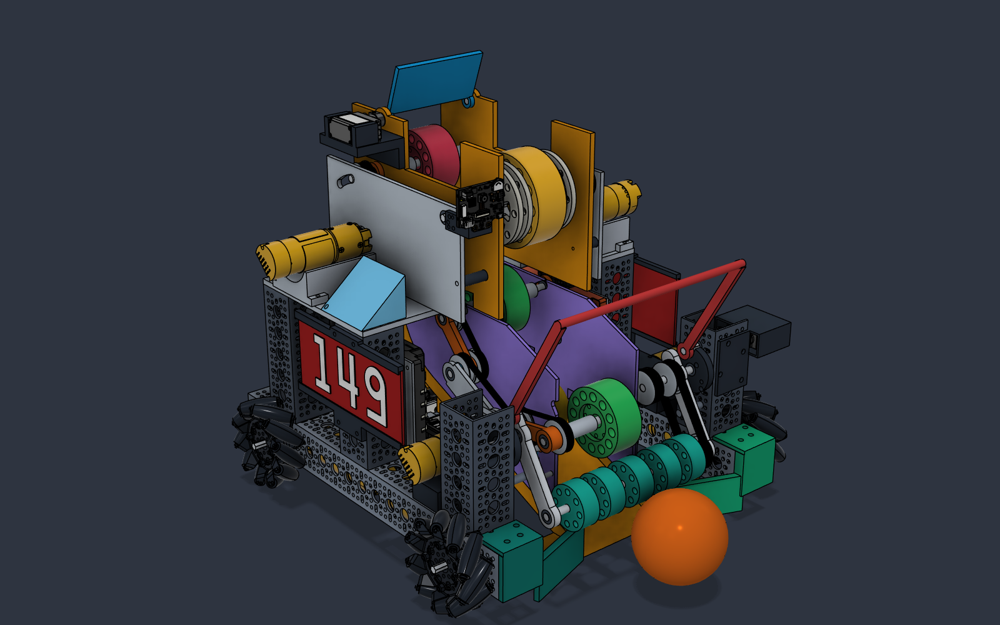
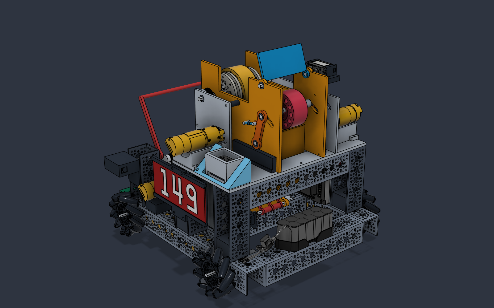
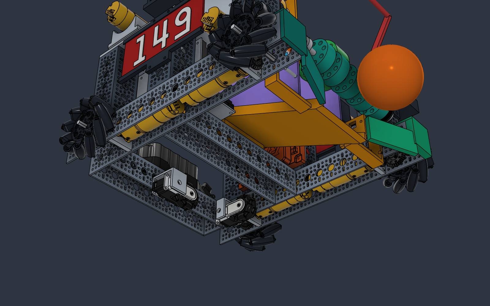
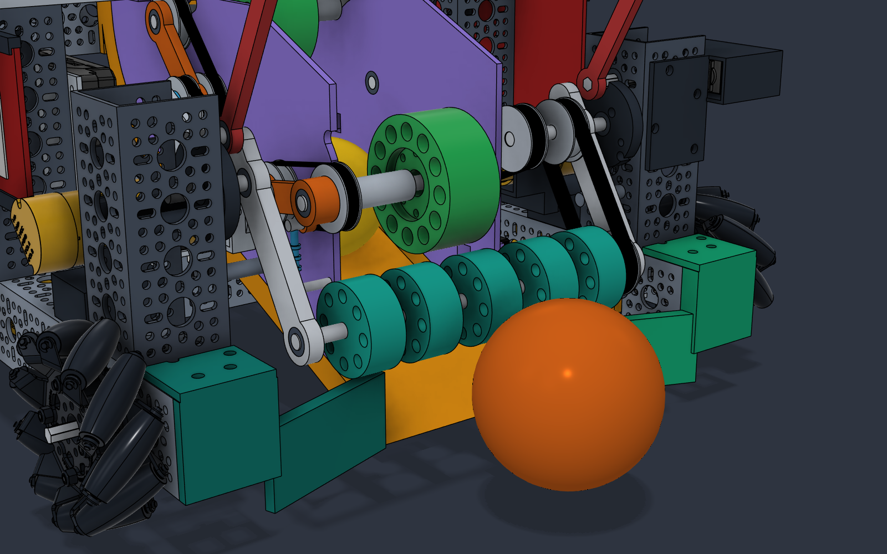
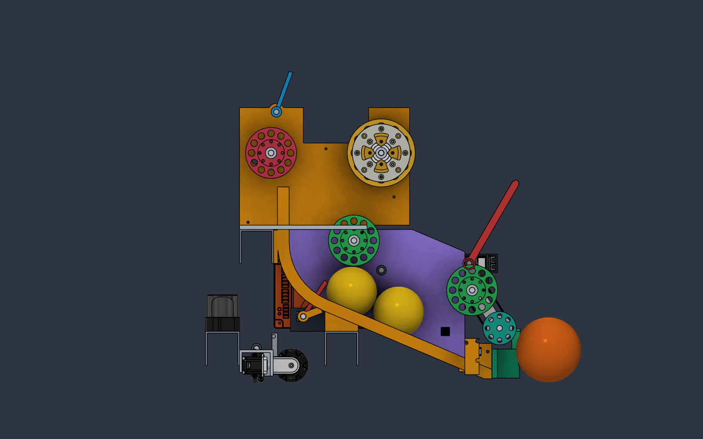
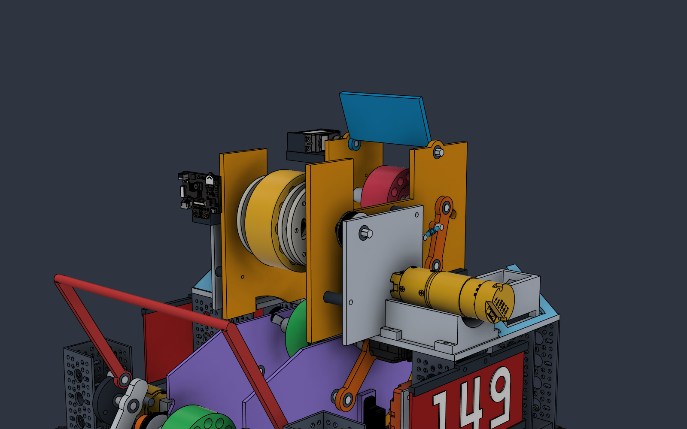
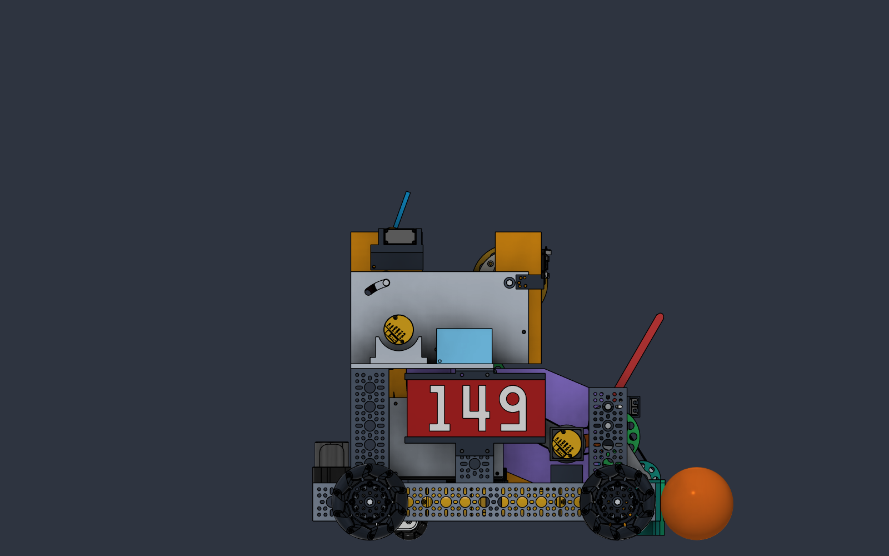
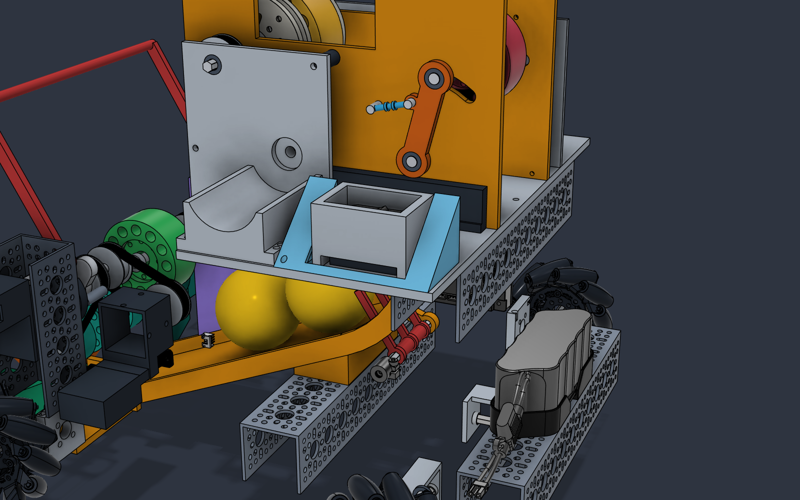

# FTC 2026–2027 BIOBUZZ™ (TU07) — Master Engineering Portfolio, Strategy Guide & "Project HIVE-QUEEN" CAD Architecture

**Prepared for:** FTC Team 149 (Captain & Lead Programmer: Danu Kim)  
**Robot Name:** Project HIVE-QUEEN (Rev 12.6 — Fusion 360 `HIVE QUEEN v111426m`, remediated from `HIVE QUEEN v111326`)  
**Envelope (stowed):** `444.0 mm (L) × 443.7 mm (W) × 439.5 mm (H)` (`17.48" × 17.47" × 17.30"`, inside the `R102` $18.0"$ starting cube) · **Expanded (intake on upper stop):** `464.8 × 443.7 × 439.5 mm` (inside `R105` `609.6 × 457 × 736.6 mm`)  
**CAD Verification Status (`cad/out/v12_gate_report.json`):** `1,808` visible solid bodies · **`0` unfiltered B-Rep interferences** (no masking cutters) · 6 mechanisms swept with 0 collisions · every custom part chained to the chassis · `0` multi-lump bodies · `91.95 mm` NECTAR clears 10 path stations · 7/7 HTD-5M belts exact · 2 pods + 4 wheels on the floor · topspin `v_rear 8.67 > v_front 5.78 m/s`  
**Manual & Sim Data Synthesized:** `BIOBUZZ_Competition_Manual_TU07.pdf` (Updated October 29, 2026) + Official Q&A Rulings (Q1–Q29) + Event Field Setup Guide V1.0 + NCSSM 12,000-Match Physics Simulator (`biobuzz.ncssmftc.org`).

### Documentation Suite Index
* **[`docs/01_ARCHITECTURE_AND_GAME_STRATEGY.md`](docs/01_ARCHITECTURE_AND_GAME_STRATEGY.md)** — General Overview, Game Rules (`TU07`), HIVE Ballast & Tipping Math, Why Fixed-Mount Shooter Beats Swivel Ring, and Autonomous/TeleOp Match Playbook.
* **[`docs/02_SUBSYSTEM_ENGINEERING_AND_DESIGN_CHOICES.md`](docs/02_SUBSYSTEM_ENGINEERING_AND_DESIGN_CHOICES.md)** — Part-by-Part Engineering Deep-Dive, Kinematic Equations, Exact `(X, Y, Z)` Coordinates, and Design Evolution for all Subsystems.
* **[`docs/03_AI_AGENT_FUSION360_AND_CAD_GUIDE.md`](docs/03_AI_AGENT_FUSION360_AND_CAD_GUIDE.md)** — Complete Technical Guide for AI Agents & Engineers on Driving Autodesk Fusion 360 Live via `HermesFusionBridge` (`http://127.0.0.1:18149`) and `cad/fusion_cli.py`.
* **Primary CAD Files:** [`cad/v12_design.py`](cad/v12_design.py) (single source of every coordinate) · [`cad/run_full_robot_upgrade.py`](cad/run_full_robot_upgrade.py) (v12 builder) · [`cad/verify_v12_gates.py`](cad/verify_v12_gates.py) · [`cad/STEP/project_hive_queen_robot_v12.step`](cad/STEP/project_hive_queen_robot_v12.step) · printables in `cad/3MF/v12/` · BOM `cad/out/HIVE_QUEEN_149_BOM_CHECKLIST.csv/.xlsx`

*See also [`docs/05_COMPETITION_READINESS_CHECKLIST.md`](docs/05_COMPETITION_READINESS_CHECKLIST.md) for the rules audit, analysis results and the pit checklist.*

*Figure 1: HIVE-QUEEN v12 front-right iso — asymmetrical funnel, G407 blocker (stowed), floating intake on its lower stop, 149 sign on slide rails, fixed-mount topspin shooter with HuskyLens.*

*Figure 2: HIVE-QUEEN v12 rear-left iso — strapped rear battery bay, 40° G409 shed roofs, guarded upward power switch, M5/M6 shooter motors in deck saddles, left 149 sign.*

---

## 1. Executive Summary

In **BIOBUZZ™ presented by RTX**, two alliances of two robots each compete on a $144"\times 144"$ nominal ($141.4"\times 141.4"$ actual inside perimeter) foam-tile field to collect **POLLEN** ($2.80"$, $24.95\text{ g}$ yellow perforated balls) and **NECTAR** ($3.62"$, $41.28\text{ g}$ red/blue perforated balls), launch them into the upward-facing **CELL** of their central bi-stable **HIVE** to induce **HIVE TIPS** ($20\text{ pts}$ each), extract POLLEN from the bottom of **FLOWERS**, and cap FLOWERS with NECTAR in the final 60 seconds before parking in the **LOADING ZONE**.

### The 5 Golden Truths of BIOBUZZ
1. **HIVE TIPS Dominate Both Match Score and Ranking Points:** Every HIVE TIP is worth **20 points**, unlocks **1 staged Alliance Area NECTAR** (in both Auto and TeleOp), and drives **both Pollinator Ranking Points** (**4 Tips** for Pollinator 1 RP, **7 Tips** for Pollinator 2 RP). By contrast, **FLOWERS award 0 Ranking Points** and take 6–8 elements to yield 19–21 points.
2. **The Upward CELL Rejects Backspin (44.18% Bounce-Out Rate):** Unlike DECODE's backboard goal, BIOBUZZ's upward-facing CELL is a $60^\circ$-tilted pentagonal pocket ($20"\text{ wide} \times 14"\text{ tall} \times 12"\text{ deep}$, lip at $z = 53.5"$, apex at $z = 65.6"$). Single-wheel overhand fixed-hood shooters impart heavy backspin, causing **44.18% of on-target shots to bounce out** (measured by `14343 Escape Velocity`). Topspin or zero-spin dual-wheel/counter-roller launchers are mandatory.
3. **Two Ball Sizes ($2.80"$ vs. $3.62"$) Break Fixed-Gap Shooters:** NECTAR is **1.29× wider (+20.8 mm)** and **1.65× heavier** than POLLEN. A fixed shooter gap tuned for 4 mm compression on POLLEN squeezes NECTAR by **24.8 mm (27% of its diameter)**. However, sorting into two separate shooters/turrets adds excessive mass and complexity. The winning solution is a **single-channel transfer feeding a dual-wheel launcher with a sprung or servo-cam variable gap**.
4. **No Momentary Exception for `G407` (4-Ball Cap) or `G408` (Opponent NECTAR):** Official Q&A rulings (Q3, Q4, Q23) and TU07 establish that controlling a 5th ball or an opponent's NECTAR is a penalty every time, and **any robot designed to routinely intake a 5th ball or opponent NECTAR and eject it via an internal sorter is penalized as STRATEGIC (`MAJOR FOUL + YELLOW CARD`)**. Filtering and hard-stopping **must occur at the front intake lip before capture**.
5. **AprilTags Move With the HIVE (`§9.9` & FTC SDK 12.0):** The four 4-tag AprilTag clusters (`IDs 30–45`) are mounted on the bottom faces of the rocking CELLS. They **cannot** be used for global field localization (`MegaTag2`). Dead-wheel odometry (**goBILDA Pinpoint v2**) must own field pose $(x,y,\theta)$, while SDK 12.0's `AprilTagClusterDetection` determines which CELL is up/settled and provides direct turret aiming offsets.

---

## 2. Complete Competition Manual Analysis (TU07)

### 2.1 Match Timing & Period Rules (`§9.11`, `§10.1`, `§10.4`, `G401–G404`)

| Period | Duration | Timer Display | Audio Cue | Key Rules & Restrictions |
| :--- | :---: | :---: | :--- | :--- |
| **AUTO** | `0:30` | `2:30` → `2:00` | Cavalry Charge / 3× Buzzer | Pre-programmed instructions only (`G401`). Crossing the center line (`Columns A–C` Red vs. `D–F` Blue) to contact opponent robots or control opponent-side elements is an Auto Interference foul (`G402`). |
| **Transition** | `0:08` | `0:08` → `0:01` | "Drivers, pick up your controllers, 3-2-1" | **`G403` Motionless Rule:** **NO powered movement** of the robot or any mechanism is allowed. Calling `TeleOp.init()` during transition must *not* twitch servos or pre-spin flywheels! (Coasting down from Auto is permitted). |
| **TELEOP (Main)** | `1:00` | `2:00` → `1:00` | 3 Bells | Drivers operate robots. One staged NECTAR unlocked per HIVE TIP (`G426.A`). Placing NECTAR in a FLOWER before `1:00` is a **MAJOR FOUL (20 pts) per NECTAR** (`G410`). |
| **TELEOP (Endgame)** | `1:00` | `1:00` → `0:00` | Chime (`1:00`) / Train Whistle (`0:20`) | **FLOWERS unlock for NECTAR scoring** (`G410`) and **all remaining staged NECTAR** in the Alliance Area may be entered through the LOADING ZONE (`G426.B`). |
| **Post-Match** | — | `0:00` | 3-sec Buzzer | **`G404` Motionless Rule:** Robots must cease all powered movement at `0:00`. HIVE TIPS and element scoring are assessed after all elements/robots come to rest (`§10.5.A–E`). |

---

### 2.2 Scoring Values & Ranking Point (RP) Thresholds (`§10.5.5`, Tables 10-2 & 10-3)

| Achievement | AUTO Points | TELEOP Points | Ranking Point Tie-In & Rules Reference |
| :--- | :---: | :---: | :--- |
| **LEAVE** (per robot) | **3 pts** | — | Robot no longer contacting perimeter wall at end of AUTO (`§10.5.4`, Q&A Q21). Counts toward **SWARM RP**. |
| **PARK** (per robot) | **5 pts** | **5 pts** | Robot at least partially inside its $23"\times 11"$ **LOADING ZONE** at end of period (`§10.5.4`). Counts toward **SWARM RP**. |
| **HIVE TIP** | **20 pts** | **20 pts** | Downward CELL becomes upward CELL and damper contacts frame (`§10.5.1`). Induced **only** by launching into upward CELL (`G417`). Counts toward **POLLINATOR 1 & 2 RPs**. |
| **Element Remaining in Upward CELL** | — | **2 pts each** | Any POLLEN or NECTAR resting in your upward-facing CELL at match end (`§10.5.1`). |
| **FLOWER Bottom NECTAR Bonus** | — | **5 pts** | Earned by the alliance whose color NECTAR is the **bottom-most NECTAR** inside a FLOWER's scoring volume (`§10.5.2`). |
| **Elements in an Owned FLOWER** | — | **2 pts each** | Alliance with the **top-most NECTAR** of its color owns the FLOWER and scores **2 pts for every POLLEN and NECTAR** inside that FLOWER (`§10.5.2`). |
| **GARDEN** | — | **1 pt each** | Any POLLEN or NECTAR (either color!) at least partially in your $23"\times 2"$ corner GARDEN (`§10.5.3`). |

#### Ranking Points (Max 6 RP per Qualification Match)
* **WIN:** **3 RP** (`TIE`: **1 RP**)
* **SWARM RP (1 RP):** Combined `AUTO LEAVE + AUTO PARK + TELEOP PARK` $\ge$ **16 points** (at Qualifying/League events; Regional/Worlds TBA).
  * *How to hit 16 pts:*
    * **Standard Cooperative:** Both robots Leave in Auto ($3+3=6$), 1 robot Auto Parks ($+5=11$), 1 robot TeleOp Parks ($+5=16$); OR both robots Leave in Auto ($3+3=6$) and both TeleOp Park ($5+5=10 \rightarrow 16\text{ pts}$).
    * **Solo Guarantee (Partner has no Auto):** Your robot Leaves ($3$) + Auto Parks ($5$) and gently nudges your partner into the Loading Zone or off the wall in Auto, then both park in TeleOp ($5+5$).
* **POLLINATOR 1 RP (1 RP):** $\ge$ **4 HIVE TIPS** (Qualifying/League threshold).
* **POLLINATOR 2 RP (1 RP):** $\ge$ **7 HIVE TIPS** (Qualifying/League threshold).

---

### 2.3 Exact Field, Element & HIVE Calibration Specs (`§9.2–§9.9`, CAD & EFSG `§12.3`)

#### Scoring Elements (`§9.8`, `§10.3.1`)
| Property | POLLEN (`am-5851_yellow`) | NECTAR (`am-5852_red` / `am-5852_blue`) |
| :--- | :--- | :--- |
| **Material** | Gopher ResisDent™ hollow perforated polyethylene | Gopher ResisDent™ hollow perforated polyethylene |
| **Diameter** | **$2.80\text{ in.}$ ($71.1\text{ mm}$)** | **$3.62\text{ in.}$ ($91.95\text{ mm}$)** ($1.29\times$ Pollen) |
| **Mass** | **$0.055\text{ lb}$ ($24.95\text{ g}$)** | **$0.091\text{ lb}$ ($41.28\text{ g}$)** ($1.65\times$ Pollen) |
| **Perforations** | 26 holes, **$11.2\text{ mm}$** diameter | 26 holes, **$16.1\text{ mm}$** diameter |
| **Total Count** | **40 yellow** (scorable by either alliance) | **8 Red + 8 Blue** (scorable only by matching alliance; `G408` bans controlling opponent's) |
| **Match Start Staging** | • **16 Pre-loaded:** 4 per robot (`G304.G`) • **16 in FLOWERS:** 4 stacked per FLOWER • **8 in GARDENS:** 4 in Red (`A1`), 4 in Blue (`F6`) | • **6 in Upward CELLS:** 3 Red in Red up-CELL, 3 Blue in Blue up-CELL • **10 in ALLIANCE AREAS:** 5 Red, 5 Blue (1 unlocked per HIVE TIP; all unlocked at `1:00` left) |

#### HIVE & CELL Geometry (`§9.6`, `data/field.json` CAD Verification)
* **Frame Footprint:** $49.46"\text{ wide } (x) \times 38.95"\text{ deep } (y)$ at center of field $(0,0)$.
* **Pivot Axis:** Parallel to $x$-axis at $y = 0, z = \mathbf{43.95\text{ in.}}$
  * Red HIVE center: $x = \mathbf{-12.75\text{ in.}}$ (starts with Audience-side CELL tilted UP, $\sigma = -1$).
  * Blue HIVE center: $x = \mathbf{+12.75\text{ in.}}$ (starts with Scoring-table/Far-side CELL tilted UP, $\sigma = +1$).
* **Upward CELL Opening:**
  * Pentagonal prism mouth: **$20.0\text{ in. wide} \times 14.0\text{ in. tall} \times 12.04\text{ in. deep}$**, tilted **$30^\circ$ arm angle** ($60^\circ$ mouth plane from horizontal).
  * **Mouth Lower Lip:** $z = \mathbf{53.50\text{ in.}}$ above tiles, horizontal offset $u = 19.27\text{ in.}$ from pivot.
  * **Mouth Upper Apex:** $z = \mathbf{65.62\text{ in.}}$ above tiles, horizontal offset $u = 12.27\text{ in.}$ from pivot.
  * **Mouth Centroid (Optimal Aim Target & AprilTag Cluster Origin):** $z = \mathbf{58.32\text{ in.}}$, $u = \mathbf{16.49\text{ in.}}$ from pivot line.
* **HIVE Tipping Calibration Table (`Event Field Setup Guide §12.3`), corrected in v12:**
  * Each HIVE is calibrated so that **$\le 174\text{ g}$ does NOT tip** and **$\ge 199\text{ g}$ MUST tip**. Between the two is undefined, so we plan every tip to **$\ge 206\text{ g}$** (a 7 g margin for ball-mass tolerance, calibration and bounce-outs).
    * **First tip of the match (3 pre-staged NECTAR = $123.84\text{ g}$):**
      * $+3\text{ POLLEN}$ = $198.69\text{ g}$, **below 199 g, so it is not guaranteed** (v11 wrongly called this a tip).
      * **$+4\text{ POLLEN}$ = $223.64\text{ g}$ = TIPS.** Fire **all 4 preloads**.
    * **Subsequent tips (empty CELL), fewest balls at $\ge 206\text{ g}$:**
      * `5 NECTAR` ($206.40\text{ g}$) = **5 balls**, the fastest
      * `4 NECTAR + 2 POLLEN` ($215.02\text{ g}$) = **6 balls** (4N+1P = 190.07 g fails)
      * **Every option here needs two loads** (G407: max 4 balls per robot): one robot's 4 + the partner's 1-2, or a second trip.
      * `2 NECTAR + 5 POLLEN` ($207.31\text{ g}$) = **7 balls**
      * `3 NECTAR + 4 POLLEN` ($223.64\text{ g}$) = **7 balls** (3N+3P = 198.69 g fails)
      * `1 NECTAR + 7 POLLEN` ($215.93\text{ g}$) = **8 balls**
      * `9 POLLEN` ($224.55\text{ g}$) = **9 balls** (8 POLLEN = 199.60 g is marginal)

#### FLOWER Geometry (`§9.7`, `§10.5.2`, `G418`)
* **4 FLOWERS** mounted on perimeter walls at $(\pm 23.5", \pm 68.2")$.
* **Top Scoring Opening:** **$4.0\text{ in.}$ inner diameter** at **$z = 21.5\text{ in.}$** above tiles, with a $1.25"$ backstop (top at $22.75"$).
  * *Critical clearance note:* Because NECTAR is **$3.62\text{ in.}$** in diameter, there is only **$0.38\text{ in.}$ ($9.6\text{ mm}$) total clearance** ($4.8\text{ mm}$ per side) to drop NECTAR into the top of a FLOWER! Launching NECTAR from a distance into a FLOWER is virtually impossible; a mechanical drop/guide arm is required.
* **Bottom Retrieval Opening:** **$3.55\text{ in. tall} \times 3.57\text{ in. deep}$** at the base, with a $0.4"$ tall floor ring ($2.79"$ inner hole). Only **POLLEN ($2.80"$)** can be extracted from the bottom (`G418.B`).

---

### 2.4 Critical Gameplay & Construction Rules Checklist (`Sections 11 & 12`)

| Rule | Headline & Core Requirement | Design & Strategy Implication |
| :--- | :--- | :--- |
| **`G304`** | **Starting Setup:** Touching perimeter wall, not in Loading Zone or Flower volume, holding/contacting **exactly 4 pre-loaded POLLEN**. | Pre-loaded POLLEN may extend outside the $18"$ starting cube (`R102` note), but robot structure must be inside $18"\times 18"\times 18"$. |
| **`G403` / `G404`** | **Motionless in Transition & Post-Match:** Zero powered movement during the 8s Auto$\rightarrow$TeleOp transition and after `0:00`. | Gate all `TeleOp.init()` servo/motor commands behind `waitForStart()`! |
| **`G407` + Q&A Q3/Q23** | **No More Than 4 at a Time:** Max 4 elements controlled simultaneously. **No momentary exception.** Routine 5th-ball intake+eject is **STRATEGIC (`MAJOR FOUL + YELLOW CARD`)**. | Must use an active **front-lip hard-stop gate** that physically blocks a 5th ball the instant 4 balls are counted inside the robot. |
| **`G408` + Q&A Q4** | **Don't Control Opponent NECTAR:** Never control opponent's NECTAR. Repeated control is **STRATEGIC (`YELLOW CARD`) even if an automatic sorter discards it**. | Must sense and reject opponent NECTAR **at the front intake lip before capture** (deflecting/bulldozing is legal per `G407.D/E`). |
| **`G409` + Q&A Q17** | **Don't Catch Spills:** Cannot catch or deflect elements falling from *either* tipping HIVE before they hit the floor. | Add $>35^\circ$ sloped top guards over the robot and program drive alerts when either HIVE tips. |
| **`G410`** | **NECTAR into FLOWERS Only in Last 60s:** Entering NECTAR into a FLOWER before `1:00` remaining = **MAJOR FOUL (20 pts) per NECTAR**. | No FLOWER mechanism (capper removed in Rev 12.2): the robot never puts NECTAR into a FLOWER, so G410 can't be broken. |
| **`G417`** | **No HIVE Meddling:** Only launch into the upward-facing CELL. Do not ram the HIVE frame or deliberately shoot the underside/sides of a CELL. | Pause firing when vision detects the CELL is mid-tip (`§10.5.1` warns mid-tip impacts can prevent the damper from touching the frame!). |
| **`G418`** | **No FLOWER Meddling:** Only enter POLLEN/NECTAR into the top of a FLOWER; only remove POLLEN from the bottom of a FLOWER. | Concave alignment bumpers that wrap partially around FLOWER pipes without grasping/attaching are explicitly **legal (`G415` note)**. |
| **`R102` / `R104` / `R105`** | **Size & Expansion Limits:** Start in **$18"\times 18"\times 18"$**; expand up to **$18"\times 24"\times 29"\text{ tall}$**; **mechanically constrained (`R105.B`)**; **no weight limit (`R104`)**. | Opponents can legally raise a **$29"$ tall shot-blocker shield** (Q&A Q2/Q8/Q20). Turret + high-angle pitch ($60^\circ\text{–}82^\circ$) shoots right over blockers. |
| **`R501–R505`** | **Actuator Limits:** Max **8 DC motors** and **8 servos** ($\le 8\text{W}$ mechanical output, $\le 4\text{A}$ stall @ 6V). | Use **REV Control Hub + Expansion Hub + REV Servo Hub / goBILDA 6V Servo Power Injector** so high-torque servos get full 6V rail. |
| **`R701–R708`** | **Vision & Sensors:** **Limelight 3A (`LL_3A`)** is explicitly legal (`Table 12-9`), plus UVC webcams, Pinpoint v2, ToF, and color sensors. **No FTC Dashboard video/telemetry streaming during matches (`R704.D`)!** | Add a "Competition Mode" flag that disables `FtcDashboard` / `Panels` Wi-Fi packets during official matches to comply with `R704.D`. |

---

## 3. Evaluation of Current Community Robot Archetypes (Reddit, YouTube, CD, GitHub)

| Archetype | Notable Teams / Sources | Mechanism Summary | Strengths | Weaknesses / Pitfalls | Meta Rating |
| :--- | :--- | :--- | :--- | :--- | :---: |
| **1. DECODE Copy-Paste (Overhand Single-Wheel Fixed Hood)** | `14343 Escape Velocity` (Ri3D v1), early `r/FTC` builds | Single 96 mm Rhino wheel @ 6000 RPM pressing ball against curved polycarb hood. | Familiar from DECODE; uses 1–2 motors. | **44.18% bounce-out rate** in upward CELL due to backspin! Fixed gap cannot shoot both Pollen & Nectar. | **4 / 10** *(Avoid)* |
| **2. Underhand Topspin / Dual-Wheel Pollen Speedster** | **`13684 Infinity Tech`** (Saline WAC & Inspire, undefeated), **`19705 WXYZ`**, **`LILRINO71`** | `13684`: Underhand 72 mm Rhino @ 6000 RPM up $75^\circ$ ramp (topspin) + Flower de-pollinator. `19705`/`LILRINO71`: Dual wheels (zero spin). | **Zero bounce-outs** (topspin grabs back wall of CELL); ultra-lightweight; fast cycles. | Early `13684` was Pollen-only — vulnerable to opponents hoarding 28 Pollen in Flowers ("Flower starvation"). | **8.5 / 10** *(Elite if upgraded for Nectar)* |
| **3. Passive "Potato Sorter" + Dual Shooters / Dual Turrets** | **`12736 Electric Mayhem Green`**, **`24813 SCHA Happy Hawks`**, **`19564 ITKAN Solar`**, **`7129 Ri30H`** | Gravity/rail gap sorter separates $2.8"$ Pollen and $3.6"$ Nectar into two separate magazines & shooters/turrets. | Each shooter has fixed compression for one ball size; zero switching delay. | Heavy (+4–6 kg costs **-24 to -36 pts/match** in sim!); consumes motor/servo budget; hard to enforce `G407` 4-ball cap across 2 lanes. | **6 / 10** *(Over-engineered trap)* |
| **4. 4-Wide Burst Catapult / Multi-Radius Drum** | **`NCSSM Sim Meta Build`**, **`30564 WIRE WE Doing This?`**, **`Robits StarterBot+`**, `r/FTC` tank-drums | Wide catapult or multi-slot drum that launches up to 4 balls at once regardless of diameter. | **+60 pts/match** in sim from instant 4-ball burst release & faster HIVE tip overload (1.2s vs 1.7s). | Narrow distance window (must park at exact standoff); hard to turret or shoot over a 29" blocker; high shock loads. | **7.5 / 10** *(Best low-resource build)* |
| **5. Single-Channel Dual-Element Turret + Active/Sprung Gap + Flower Pass-Through** | **`12649 Code Blooded`**, **`14343 Escape Velocity` (v4)**, **`37032 Rivers Edge`**, **`25609 LOAD`**, **`16750 Technototes`** | Wide intake $\rightarrow$ single-file sprung magazine $\rightarrow$ turreted shooter with counter-roller & cam/sprung gap for both balls + lightweight Flower mech. | Shoots both Pollen & Nectar with zero/topspin; rapid 0.5s 4-ball burst; immune to defense & Flower starvation. | Requires careful CAD clearances and sensor-driven software integration. | **10 / 10** *(World Championship Meta)* |

### Key Quantitative Takeaways from NCSSM's 12,000-Match Simulator (`caryden/ftc-biobuzz-sim`)
* **Shot Speed Consistency > Everything (-109 pts at 3× speed error vs. -25 pts at 3× yaw error):** Because the CELL mouth is $20"$ wide horizontally but shallow along the flight arc, **flywheel velocity regulation and ball compression consistency** are 4.3× more important than horizontal turret aim!
* **73% of TeleOp is Driving (87s collecting/driving vs. 6s launching):**
  * **Robot Weight Penalty:** **$-6\text{ points per match for every extra kg}$** ($15\text{ lb}$ robot scores $+20\text{ pts}$ over $22\text{ lb}$ robot and $+60\text{ pts}$ over $37\text{ lb}$ robot).
  * **Optimal Drivetrain Gearing:** **435 RPM to 500 RPM** at the wheels beats 600 RPM by **$+14\text{ pts}$** and 850 RPM by **$+46\text{ pts}$** because acceleration and stopping distance on a crowded 12-ft field beat top speed.
  * **30° Wall Sweep:** Driving at a $30^\circ$ angle with the front intake corner against the perimeter wall scoops a 4-ball HIVE spill in **0.8 seconds** (vs. 6.0 seconds driving straight).
* **Spill Timing & Location:** When a HIVE tips, it dumps ~6–8 balls along the perimeter wall behind the launch spot, taking **~2.0 seconds to land and settle**. Backing out from under the HIVE so you don't violate `G409` and sweeping the wall 2.0s later yields a full 4-ball reload instantly.

---

## 4. The Engineered CAD Architecture: "Project HIVE-QUEEN" (Rev 12 Verified Spec)

### 4.1 Architectural Overview
**Project HIVE-QUEEN v12** (stowed `444.0 × 447.6 × 445.6 mm`, **`0` unfiltered B-Rep overlaps across `1,808` visible bodies**) keeps v11's idea: one single-file ball path with **passive, belt-exact compliance** for both ball sizes. Each moving roller pivots on the axis of the pulley that drives it, so no belt ever changes length. v12 makes that idea true in the geometry. v11's clean audit relied on masking cutters; v12 removes them all, and every clearance is real.

1. **goBILDA Strafer chassis + clean miter-gear drivetrain** (4× 312 RPM, goBILDA 2315 steel 1:1 miters, 8 seated axle bearings) **+ 2-pod Pinpoint v2 odometry** (left X-pod + rear-centre Y-pod, both on the tiles).
2. **Asymmetrical funnel** (`X_max 228 / 222 mm`) **+ low wedge lip** (5 mm off the tiles, clear of tile seams) **+ G407 front-lip blocker** (S1) **+ coaxial floating intake** (R80 arms, two hard stops, 5 compliant wheels reaching `Z 53 mm`).
3. **Unified J-chute**: 23° ramp → R100 bend → vertical wall, 102 mm corridor, 12 mm curbs, 4 bolted stations, one body. **Coaxial gecko magazine:** gecko 1 on the M8 shaft, gecko 2 on jackshaft J2, true arc slots.
4. **S3 three-finger indexer gate** below the bend floor **+ throat classifier + 2 ball-count sensors** (G407 4-ball count).
5. **Fixed-mount topspin shooter**: Rhino 96 front wheel (20T:20T) + 72 mm counter-wheel (32T:16T) on **coaxial swing arms about M6**, arc slot `R 61.175 mm` (exact 245 mm belt), nip 71.5 → 93.7 mm.
6. **Hood** on `(-116, 382)` driven coaxially by S6. **HuskyLens.** **Guarded upward power switch.** **40° G409 shed roofs.** **Legal 174 × 78 mm signs (7.25 mm visible border) with 57.5 mm numerals.**

*(Full coordinates and derivations: [`docs/02_SUBSYSTEM_ENGINEERING_AND_DESIGN_CHOICES.md`](docs/02_SUBSYSTEM_ENGINEERING_AND_DESIGN_CHOICES.md).)*

---

### 4.2 Subsystem Renders (live Fusion 360, v12)

Key v12 numbers:
* **Ramp:** `z = 3.5 + tan 23° (184 − x)`, floor at `Z 81.6` over the `X ∈ [-48, 0]` mid channel.
* **Bend:** centre `(-10.0, 194.48)`, R100. **Wall:** `X = -110`.
* **Gecko 1:** rest `(161.26, 126.27)`, lift `(153.69, 149.93)`. **Gecko 2:** rest `(-6.45, 196.58)`, lift `(9.77, 206.13)`.
* **Gate pivot:** `(-78.08, 89.65)`.
* **Shooter wheels:** front `(32, 324)`, counter `(-123.5, 324)`. **M5:** `(-23.57, 266.45)`. **M6:** `(-107.71, 264.90)`.

**Belt ledger (all exact, 0.000 mm): HTD-5M 9 mm for intake + shooter, HTD-3M 6 mm for the magazine (v12.6):**

| Belt | Pulleys | C-C (mm) | Belt |
| :--- | :---: | :---: | :---: |
| Intake stage 1 (M7 → pivot) | 20T/20T | 57.5 | 215 mm / 43T |
| Intake stage 2 (pivot → floating shaft) | 20T/20T | 80.0 | 260 mm / 52T |
| Magazine b1 (M8 → gecko 1) | 33T/33T (3M) | 57.0 | 213 mm / 71T (Gates 213-3M-06) |
| Magazine b2 (M8 → J2) | 32T/32T (3M) | 81.0 | 258 mm / 86T (Gates 258-3M-06) |
| Magazine b3 (J2 → gecko 2) | 33T/33T (3M) | 57.0 | 213 mm / 71T (Gates 213-3M-06) |
| Shooter left (M5 → front wheel) | 20T/20T | 80.0 | 260 mm / 52T |
| Shooter right (M6 → counter-wheel) | 32T/16T | 61.175 | 245 mm / 49T |

---

### 4.3 Legal Actuator, Power & Sensor Budget (`Section 12`)

| # | Port | Actuator (`R501`) | Role |
| :-: | :--- | :--- | :--- |
| **M1–M4** | M1 `fl` / M2 `bl` → Expansion Hub `0/1`; M3 `fr` / M4 `br` → Control Hub `0/1` (see `docs/06_WIRING_PLAN.md`) | goBILDA 5203-2402-0019 (312 RPM) | Mecanum drive via 1:1 miter gears (all in stock) |
| **M5** | Expansion Hub `2` | goBILDA 5203-2402-0005 (1150 RPM) | Front Rhino wheel, 20T:20T → 5.78 m/s surface |
| **M6** | Control Hub `2` | goBILDA 5203-2402-0005 (1150 RPM) | Counter-wheel, 32T:16T → 8.67 m/s surface (topspin) |
| **M7** | Expansion Hub `3` | goBILDA 5203-2402-0005 (1150 RPM) | Floating intake (2-stage 20T:20T belt) → 2.83 m/s wheels, 1.8× drive top speed |
| **M8** | Control Hub `3` | goBILDA 5203-2402-0005 (1150 RPM) | Gecko magazine (b1/b2/b3). A pinched ball moves at half the gecko speed (2.17 m/s), so a lone ball coasts 239 mm across the 48.6 mm gap above gecko 2 (435 RPM stalled it 19 mm short) |

| # | Servo / sensor | Role | Location |
| :-: | :--- | :--- | :--- |
| **S1** | goBILDA 2000-0025-0002 (torque) | G407/G408 front-lip blocker | spline on `(156, 180.95, 168)` |
| **S3** | goBILDA 2000-0025-0002 (torque) | Indexer gate (3 fingers) | spline on `(-78.08, 55.3, 89.65)` |
| **S6** | goBILDA 2000-0025-0002 (torque) | Hood pitch (coaxial) | spline on `(-116, -68.1, 382)` |
| **Cam** | DFRobot HuskyLens (`R702`) | Ball/tag tracking | front-right of shooter |
| **Sens ×4** | 2× REV Color Sensor V3 + 2× REV 2m Distance | Lip G407/G408 + throat classifier (colour); 2× magazine ball count (distance) | lip `(195, 59, 50)`; left shroud windows |
| **Odom** | Pinpoint v2 + 2× Swingarm pods (48 mm wheel) | Field pose `(x, y, θ)` | left X-pod, rear-centre Y-pod |
| **Pwr** | REV main switch (`R603`) + goBILDA servo power module | Upward switch in a 4-sided cage; 6 V servo rail | deck rear-left; under deck |

---

## 5. Software & Control Architecture (FTC SDK 12.0 + Pedro Pathing 3.0.2)

### 5.1 Core Stack & Loop-Time Optimization (<3.5 ms Loop Time)
* **SDK & Pathing:** **FTC SDK v12.0** + **Pedro Pathing v3.0.2 (`Foresight` follower)** + **SolversLib v0.3.6**.
* **Hardware Bulk Caching:** Both hubs set to `LynxModule.BulkCachingMode.MANUAL` with a single `clearBulkCache()` at the start of every `loop()`. Duplicate motor/servo writes are filtered with a $\Delta > 0.005$ threshold.
* **Localization vs. Vision Separation:**
  * **Odometry (`goBILDA Pinpoint v2`):** Owns global field pose $(x, y, \theta)$.
  * **Vision (DFRobot HuskyLens + webcam `AprilTagClusterDetection`, see `TeamCode/.../hivequeen/subsystems/`):** Tracks the 4-tag clusters on the bottom of the HIVE CELLS (`30–33` Red Far, `34–37` Red Audience, `38–41` Blue Audience, `42–45` Blue Far).
    * **CELL State Classifier:** If the cluster's roll angle $< 90^\circ$ and pitch matches the $30^\circ$ rest stop for $\ge 250\text{ ms}$, the CELL state is `UP_SETTLED`. If the tags disappear or are rotating, the state is `TIPPING_UNKNOWN` (which pauses firing so shots don't disrupt the damper contact per `§10.5.1`).
    * **Heading-Lock Aiming (fixed-mount shooter):** the mecanum drive holds heading to the CELL using Pinpoint pose + yaw-rate feedforward, and blends in the camera's direct cluster bearing whenever the upward CELL's tags are in view.

### 5.2 Voltage-Scaled Feedforward Flywheel Controller & 2D Shot Map
* Run `M5` and `M6` in `DcMotor.RunMode.RUN_WITHOUT_ENCODER` using a custom voltage-compensated `kS + kV + kA + kP` loop:
  $$P_{\text{motor}} = \text{clamp}\left(\frac{12.5\text{ V}}{V_{\text{battery}}} \cdot \left(k_S \cdot \text{sgn}(\omega_{\text{ref}}) + k_V \cdot \omega_{\text{ref}} + k_A \cdot \dot{\omega}_{\text{ref}}\right) + k_P \cdot (\omega_{\text{ref}} - \omega_{\text{meas}}), -1.0, 1.0\right)$$
* **Ball-Type Transfer Efficiency Scalar (`BallType.java`):**
  * Compute the required ball exit speed $v_0(d, \phi)$ and pitch $\theta(d, \phi)$ from a 2D lookup table indexed by **radial distance $d \in [14", 70"]$** and **off-axis bearing $\phi \in [0^\circ, 75^\circ]$** (since shooting from $45^\circ\text{–}60^\circ$ to the side of the pentagonal CELL requires up to $+8^\circ$ steeper pitch).
  * Convert $v_0$ to target flywheel RPM using a measured transfer efficiency $\eta_{\text{pollen}}$ (nip at its 71.5 mm rest gap) vs. $\eta_{\text{nectar}}$ (counter-wheel pushed open along the arc slot to about 92 mm). The throat classifier chooses the curve before S3 opens.

### 5.3 High-Scoring Autonomous & TeleOp Playbook
* **Autonomous Routine (Rev 12.2, as coded in `HiveQueenAutoBase`; 28–48 pts solo; no FLOWER interaction):**
  * **Start:** touching the wall with **3 POLLEN in the magazine and the 4th on the tiles touching the front funnel**. A 4th inside would lift the floating intake to 456.1 mm against the 457 mm R102 limit.
  1. **`0–1.5 s` LEAVE + pick-up (`LEAVE = 3 pts`):** drive 300 mm off the wall with the intake running to take in the 4th preload.
  2. **`≤ 3.5 s` drive to the launch pose while spinning up:** robot centre about 1.55 m from the HIVE pivot line, D ≈ 1.07 m from the CELL lip, inside the 0.75–1.25 m reliable window.
  3. **`≤ 1 s` aim, `≤ 3 s` fire:** vision heading-lock on the **up** CELL's tag cluster, then fire 4 POLLEN. 3 NECTAR + 4 POLLEN = 223.6 g → **HIVE TIP #1 (+20)**. If the 4th was missed, it fires 3 (198.7 g, under the must-tip line), so tip #1 is uncertain.
  4. **Collect / fire loop:** wait 1.5 s for the spill to settle (G409), sweep the spill along the wall, pick up the Loading-Zone NECTAR, and fire at the far-side CELL to try for **TIP #2 (+20)**.
  5. **`24.0 s` hard abort → PARK (`+5`):** from any state, drive into the Loading Zone; the drive is cut at 29.5 s. LEAVE + PARK from both robots = 16 = **Swarm RP threshold**.
  * **Why no de-pollinator / FLOWER extraction:** RPs are alliance-wide tip counts for the whole match (4 tips = Pollinator 1, 7 = Pollinator 2), and every tip spills its balls back onto the field. The limit is cycle time, not FLOWER POLLEN.
* **TeleOp Cycle & Endgame Strategy:**
  * **`2:00` to `0:25`:** Both alliance robots stay 100% focused on **HIVE TIP cycling** from separated launch spots ($0.62\text{ m}$ apart, $0^\circ$ and $40^\circ$ off-axis so partners never collide). Human Player feeds unlocked NECTAR into the Loading Zone after every tip. **A tip needs about 206 g in the CELL, and G407 caps each robot at 4 balls** (4 NECTAR = 165.1 g is not enough), so a tip is **one robot's full load of 4 NECTAR plus 1 NECTAR (5N, 206.4 g) or 2 POLLEN (4N+2P, 215.0 g) from the partner** firing into the same CELL, or a second trip by the same robot. (`4N+1P` and `3N+3P` fall below the 199 g must-tip line.)
  * **`0:25` to `0:00` (Tip-Through Endgame):** At `1:00` every remaining staged Alliance NECTAR unlocks. Keep cycling **5N (206.4 g) tips** from the Loading Zone (4 from one robot + 1 from the partner: never 5 in one robot). Finish the last tip before `0:04` so the HIVE has 3+ s to rock onto its damper, then **PARK (`+5 pts`)** before `0:00`. There is no FLOWER capping: an extra tip (20 pts + RP progress) beats a cap (about 7 pts, 0 RP).
