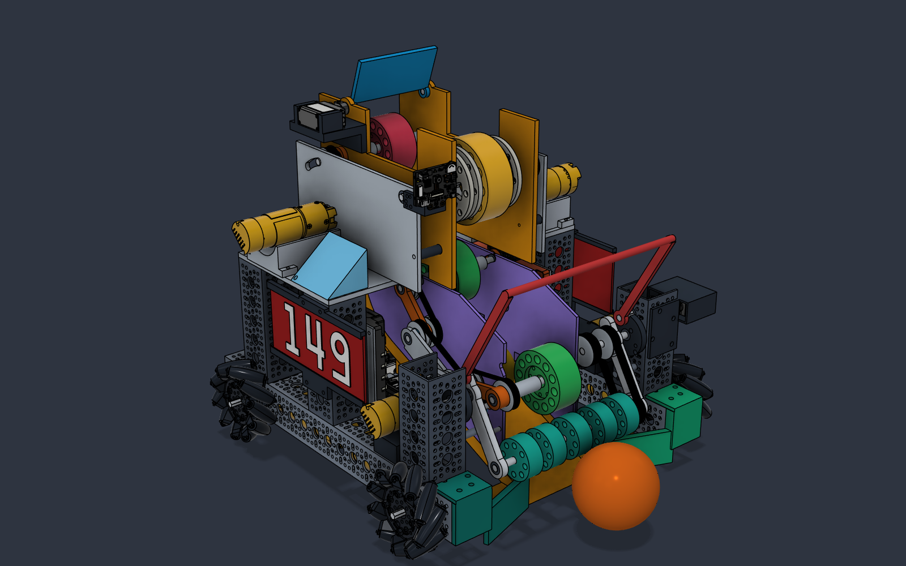

# 01 — Project HIVE-QUEEN: General Overview, Game Strategy & System Architecture

**Team:** FTC Team 149 · **Season:** 2026–2027 FIRST® Tech Challenge **BIOBUZZ™ presented by RTX (TU07)**



---

## 1. General Overview of the Challenge & Our Design Philosophy

In **BIOBUZZ™**, alliances score by collecting two sizes of hollow perforated polyethylene spheres—**POLLEN** ($\varnothing 71.12\text{ mm} / 2.80"$, $24.95\text{ g}$, yellow) and **NECTAR** ($\varnothing 91.95\text{ mm} / 3.62"$, $41.28\text{ g}$, red/blue)—and launching them high into the upward-facing pentagonal **CELL** of their central bi-stable **HIVE**. When the accumulated mass of balls inside the upward CELL reaches **$\ge 199\text{ g}$**, the HIVE rocks over its central pivot ($z = 43.95"$), dumping the balls back onto the field, bringing the opposite empty CELL up to the top, awarding **20 points for a HIVE TIP**, unlocking **1 staged Alliance Area NECTAR**, and advancing both **Pollinator Ranking Points** (**4 Tips** for Pollinator 1 RP; **7 Tips** for Pollinator 2 RP).

### Why Project HIVE-QUEEN Was Designed Around Five Core Constraints

| Game / Physics Constraint | Why Conventional Designs Fail | Project HIVE-QUEEN's Architectural Solution |
| :--- | :--- | :--- |
| **1. Dual Ball Sizes ($\varnothing 71.12\text{ mm}$ vs. $\varnothing 91.95\text{ mm}$, $+20.83\text{ mm}$ difference)** | Fixed-gap intakes and shooters either fail to touch the $71.12\text{ mm}$ Pollen ball or jam/crush the $91.95\text{ mm}$ Nectar ball ($27\%$ compression). Dual-lane "potato sorters" add $+4\text{–}6\text{ kg}$ of dead weight (costing $-24\text{ to }-36\text{ pts/match}$ in drive acceleration). | **Single-Channel Passive Spring-Loaded Compliance** across all 3 stages: (a) Coaxial Floating Front Intake (`R = 80 mm` arms between two hard stops, wheels reach `Z_min = 53 mm`), (b) 2 Coaxial Belt-on-Pivot Gecko Arms (gecko 1 on the M8 shaft, gecko 2 on jackshaft J2; `5.25°` $\rightarrow$ `30.2°` lift for Nectar), and (c) Coaxial Concentric-Arc Shooter Counter-Wheel (`71.5 mm` $\rightarrow$ `93.7 mm` gap with `0.000 mm` belt stretch). |
| **2. Steep $60^\circ$-Tilted Upward HIVE CELL ($z_{\text{lip}} = 53.50"$, $z_{\text{apex}} = 65.62"$)** | Single-wheel overhand fixed-hood shooters impart heavy backspin and launch too horizontally, resulting in a **44.18% bounce-out rate** off the back wall of the pentagonal CELL. | **Dual-Wheel Topspin Shooter + Steep $62^\circ\text{–}72^\circ$ Basketball-Arc Exit Hood:** Pairs a $\varnothing 96\text{ mm}$ front Rhino flywheel with a $\varnothing 72\text{ mm}$ rear counter-wheel so balls enter the high CELL mouth on a steep downward basketball arc with gentle topspin that grabs the back wall. |
| **3. Rigid Timing Belt Tension vs. Expanding Rollers** | If a spring-loaded roller slides along a straight linear slot while driven by a timing belt, the center-to-center distance changes, so the rigid fiberglass/kevlar HTD-5M belt either locks the slide or goes slack and skips teeth. | **Coaxial Belt-on-Pivot + Concentric Circular Arc Slots:** Both the front intake swing-arm and the rear shooter swing-arm pivot **coaxially around the drive pulley axis** (`(156, 144)`, M8 `(104, 121)`, J2 `(30.45, 152.48)` and M6 `(-107.71, 264.90)`), and every relief slot is an **exact circular annulus** (shooter: $R = 61.175\text{ mm}$ centered on Motor `M6` = the exact 245 mm / 49T belt centre distance), giving **$0.000\text{ mm}$ belt stretch** across the entire expansion range. |
| **4. Different Ball Masses ($24.95\text{ g}$ Pollen vs. $41.28\text{ g}$ Nectar)** | Even with passive mechanical gap expansion, a $41.28\text{ g}$ Nectar ball requires higher flywheel energy and a slightly different launch pitch than a $24.95\text{ g}$ Pollen ball to hit the same apex. | **Pre-Shot Optical Classification (`throat_ball_size_color_sensor`):** A REV Color/Distance Sensor V3 looking through the left magazine shroud at the ball held by the **S3 three-finger indexer gate (`indexer_stopper_gate_3prong_fingers`)** at `(-9.6, 0, 124.3)` identifies whether the staged ball is Pollen or Nectar *before* the gate opens, allowing the Control Hub to set `M5`/`M6` RPM and `servo_s6` hood pitch automatically. |
| **5. Intense Perimeter Wall Defense & Moving HIVE AprilTags** | HIVE spills land along the perimeter walls, where robot-to-robot contact can accidentally flip side-mounted power switches (`R603`), and the HIVE's AprilTag clusters rock with the CELLS so they cannot be used for global `MegaTag2` pose. | **Upward-Facing Guarded Top-Deck Power Switch (`(-114, +146, 226)`) + 2-Pod Dead-Wheel Odometry (`Pinpoint v2`):** Recesses the main switch inside a 4-sided printed PETG-CF guard cage on top of the deck plate, and uses two floor-contact swingarm dead-wheel pods (left X-pod + rear-centre Y-pod; Pinpoint v2 has exactly 2 encoder ports) for drift-free $1,500\text{ Hz}$ pose plus a front-right **DFRobot HuskyLens** for direct target tracking. |

---

## 2. Game Mathematics & HIVE Tipping Strategy

### 2.1 HIVE Ballast & Tipping Thresholds (`EFSG §12.3`), corrected v12 math
Each HIVE is calibrated so that **$\le 174\text{ g}$ does NOT tip** and **$\ge 199\text{ g}$ MUST tip**. Anything in between is undefined, so a plan that lands at 198–199 g is a coin flip. POLLEN weighs **$24.95\text{ g}$** and NECTAR **$41.28\text{ g}$**. Our planning rule is **$\ge 206\text{ g}$ in the upward CELL**: a $\ge 7\text{ g}$ margin over the must-tip line that absorbs per-ball mass tolerance, ballast-washer calibration and a ball bouncing out. (v11 counted "3 Pollen on top of the auto Nectar" = 198.69 g and 4N+1P = 190.07 g as tips. Both are **below 199 g**.)

| Scenario | Pre-existing mass | Fewest balls reaching $\ge 206\text{ g}$ | Total mass | Takeaway |
| :--- | :---: | :---: | :---: | :--- |
| **Tip #1 (Auto start)** | **3 pre-staged NECTAR ($123.84\text{ g}$)** | **4 POLLEN** ($+99.80\text{ g}$) | **$223.64\text{ g}$** | Needs **all 4 preloaded POLLEN**; 3 POLLEN (198.69 g) does **not** guarantee a tip. |
| Pure Pollen | Empty | **9 POLLEN** | $224.55\text{ g}$ | 8 POLLEN = 199.60 g is only 0.6 g over the line, so treat it as unreliable. |
| 1 Nectar + Pollen | Empty | **1 N + 7 P** (8 balls) | $215.93\text{ g}$ | |
| 2 Nectar + Pollen | Empty | **2 N + 5 P** (7 balls) | $207.31\text{ g}$ | |
| 3 Nectar + Pollen | Empty | **3 N + 4 P** (7 balls) | $223.64\text{ g}$ | 3N + 3P = 198.69 g fails. |
| 4 Nectar + Pollen | Empty | **4 N + 2 P** (6 balls) | $215.02\text{ g}$ | 4N + 1P = 190.07 g fails. |
| **5 Nectar** | Empty | **5 N** (5 balls) | **$206.40\text{ g}$** | Fastest cycle when the Human Player feeds unlocked NECTAR (`G426.A`). |

### 2.2 Why We Removed the Swivel Turret Ring in Favor of a Fixed-Mount Shooter on a 312 RPM Holonomic Chassis

In early conceptual drafts, we considered mounting the shooter on a rotating bearing ring (`turret_bearing_ring_85mm`) driven by an azimuth servo (`servo_s4`). During extensive CAD verification in Fusion 360, we eliminated the swivel turret ring and bolted the shooter side plates directly to the flat aluminum top deck (`cnc_turret_mounting_deck_plate_clean`) for four decisive engineering reasons:
1. **Continuous J-Chute Throat Geometry:** Because our single-file magazine (`unified_continuous_j_chute` + 2 coaxial gecko arms) is fixed to the chassis and feeds both $\varnothing 71.12\text{ mm}$ and $\varnothing 91.95\text{ mm}$ balls up a $102\text{ mm}$-wide corridor directly into the nip between the front $\varnothing 96\text{ mm}$ flywheel and rear $\varnothing 72\text{ mm}$ counter-wheel, rotating the shooter in yaw relative to the rectangular magazine throat would misalign the $91.95\text{ mm}$ ball entry path and cause severe geometric clipping between the turret ring, the upper Gecko wheel, and the intake/magazine shrouds.
2. **NCSSM Simulator Proof (Velocity & Pitch Consistency > Yaw Turret by 4.3×):** The upward HIVE CELL opening is a massive **$20.0\text{ inches}$ ($508\text{ mm}$) wide horizontally**, giving huge yaw forgiveness, whereas its倾斜 depth window along the parabolic trajectory is tight. NCSSM's 12,000-match simulator proved that $3\times$ speed/compression error costs **$-109\text{ points/match}$**, whereas $3\times$ yaw error costs only **$-25\text{ points/match}$**.
3. **Zero Structural Play under `91.95 mm` Nectar Shock Loads:** Bolting the $6\text{ mm}$ shooter side walls (`turret_side_plate_left/right_clean`) and outboard double-shear motor plates (`turret_outboard_double_shear_plate_left/right`) to the $6\text{ mm}$ CNC aluminium top deck (printed PETG-CF L-brackets, plus M4 through-bolted standoff tubes between the shear plates and side walls; v12.6 keeps every aluminium plate a flat 2D cut part) creates a rigid box-beam structure with no bearing-ring slop when a $41.28\text{ g}$ Nectar ball goes through the nip at about $1,050\text{ RPM}$.
4. **Instant Holonomic Heading Lock via 2-Pod Odometry + HuskyLens:** With four `312 RPM` goBILDA 5203 drivetrain motors (1:1 miter gears, all in stock), 2-pod swingarm dead-wheel odometry on `Pinpoint v2` (its IMU supplies heading), and the front-right **DFRobot HuskyLens**, the Mecanum drivetrain snaps its heading to the $20"$-wide CELL center while driving in $<120\text{ ms}$.

---

## 3. Match Playbook (Autonomous & TeleOp)

```mermaid
sequenceDiagram
    participant Robot as Project HIVE-QUEEN
    participant Sensor as Throat Color/Dist Sensor V3
    participant Gate as Red Stopper Gate (Servo S3)
    participant Shooter as Coaxial Dual-Wheel Shooter (M5/M6 + Servo S6)
    participant Hive as Central HIVE (Upward CELL)

    Note over Robot,Hive: 1. High-Speed Sweep & Staging (Gate CLOSED)
    Robot->>Robot: Asymmetric funnel + floating intake (wheels Z_min 53 mm) scoop Pollen & Nectar
    Robot->>Sensor: Gecko 1 -> J2 -> Gecko 2 queue the lead ball at the S3 gate (-9.6, 0, 124.3)
    Sensor->>Shooter: Reads Diameter & Hue (71mm Yellow Pollen vs 92mm Alliance Nectar)
    Shooter->>Shooter: Sets M5/M6 RPM & Servo S6 Hood Pitch (62°–72° Basketball Arc)
    Note over Robot,Hive: 2. 0.55s 4-Ball Burst Launch (Gate OPEN)
    Gate->>Shooter: Servo S3 drops 3 fingers below the bend floor; Gecko 2 feeds balls into the nip
    Shooter->>Hive: Passive Concentric Arc Slot expands (71.5mm -> 92mm) with 0.0mm belt stretch
    Hive->>Hive: >=199g threshold reached -> HIVE TIPS (+20 pts & unlocks 1 Nectar!)
```

### 3.1 Autonomous Routine (`0:30` Period)
Start with **3 POLLEN in the magazine and the 4th on the tiles touching the front funnel** (legal per §10.3.4; a 4th inside would push the robot to 456.1 mm against R102's 457 mm).
1. **`0–1.5 s` (LEAVE, +3):** drive 300 mm off the wall with the intake on, picking up the 4th preload.
2. **`≤ 7.5 s` (HIVE Tip #1, +20):** spin up on the way to the launch pose, robot centre about 1.55 m from the HIVE pivot line (D ≈ 1.07 m from the CELL lip, inside the shooter's reliable 0.75–1.25 m window). Heading-lock on the **up** CELL's tag cluster and fire 4 POLLEN: 3 NECTAR + 4 POLLEN = 223.6 g.
3. **`→ 24 s` (Tip #2 attempt, +20):** wait 1.5 s for the spill to settle (G409), sweep the spilled balls along the wall plus the Loading-Zone NECTAR, then fire at the newly raised far-side CELL.
4. **`24 s` hard abort → AUTO PARK (+5)** in the Loading Zone from any state; the drive is cut at 29.5 s. With both robots, LEAVE + PARK = 16 = Swarm RP.

No FLOWER interaction (no de-pollinator, no capper): ball supply recirculates through tip spills, so cycle time is what matters.

### 3.2 TeleOp & Endgame Playbook (`2:00` Period)
* **`2:00` to `0:20` (High-Tempo Mixed Nectar/Pollen Tip Cycling):**
  * Prioritize **5 Nectar (5-ball, 206.4 g)**, **4 Nectar + 2 Pollen (6-ball, 215.0 g)** and **2 Nectar + 5 Pollen (7-ball, 207.3 g)** tips (3N+3P = 198.7 g and 4N+1P = 190.1 g are **below** the 199 g must-tip line, so never plan on them) by coordinating with the Human Player at the Loading Zone (`G426.A`) and sweeping the perimeter wall 2.0 seconds after every tip.
  * Because the floating intake rides up on its arms (no fixed lower crossbar) and the chute's wedge lip sits 5 mm above the tiles (clear of foam-tile seams), the robot ingests mixed $\varnothing 71.12\text{ mm}$ Pollen and $\varnothing 91.95\text{ mm}$ Nectar balls at full drive speed without slowing down or sorting.
* **`0:20` to `0:00` (Final Tip Volley + Loading Zone Park):**
  * Complete the final HIVE TIP before `0:04` (giving the HIVE 3+ seconds to rock and contact the lower frame damper before `0:00` per `§10.5.1`) and park inside the Loading Zone (`+5 pts`) before the buzzer (`G404`).
