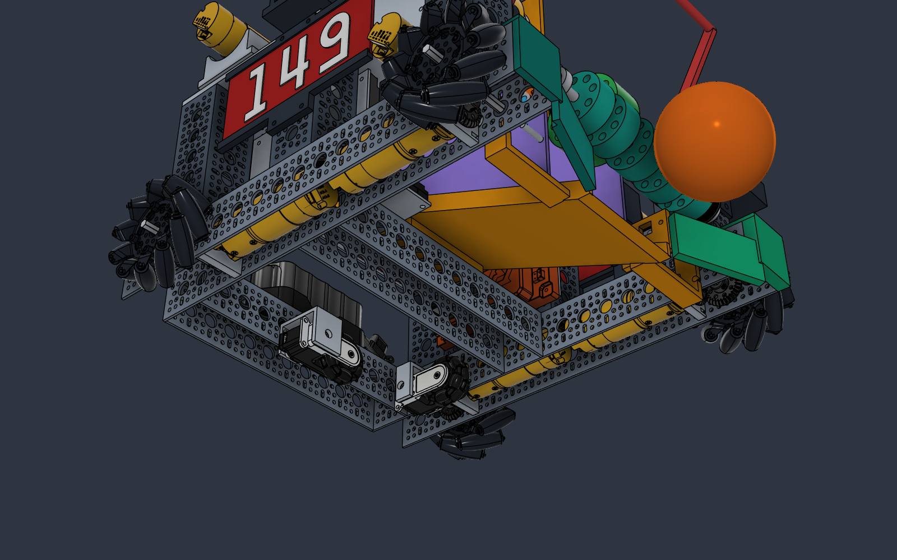
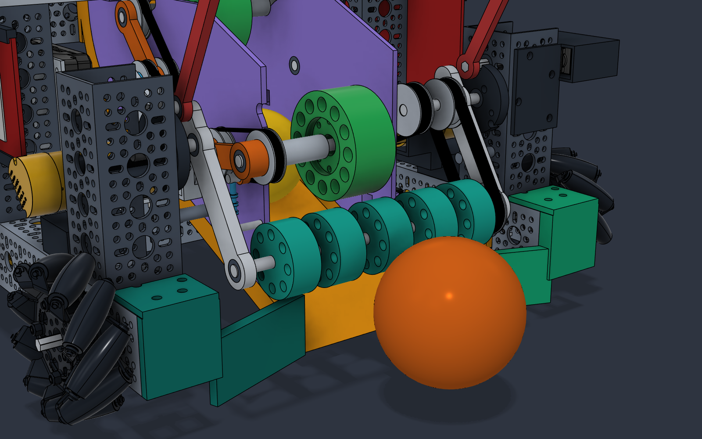
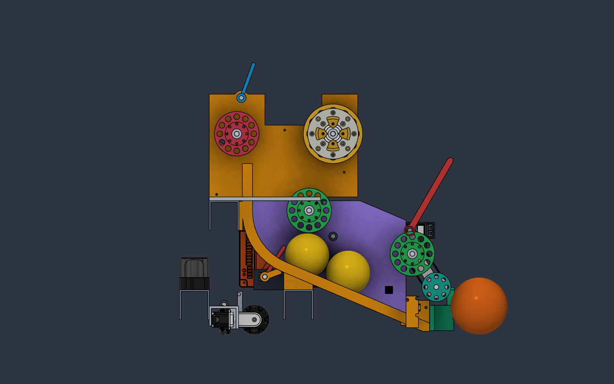
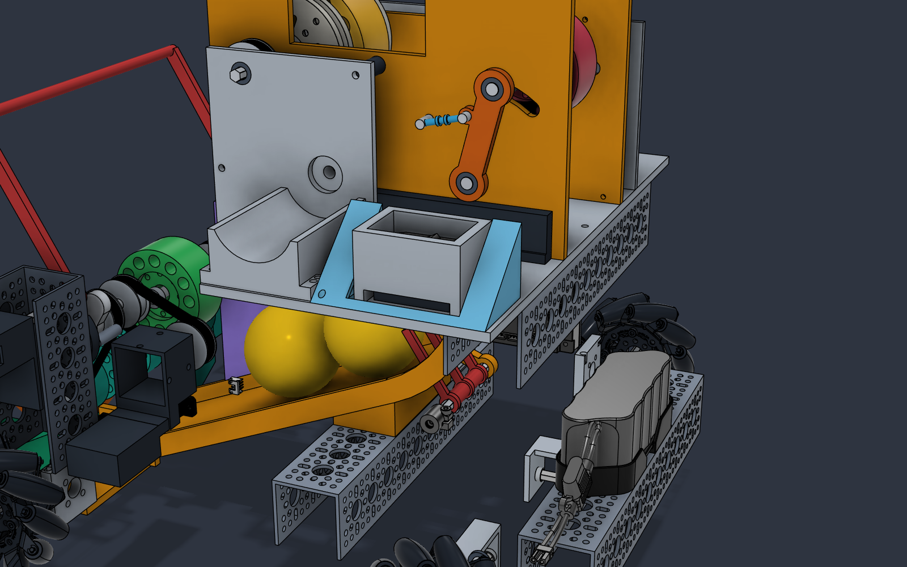
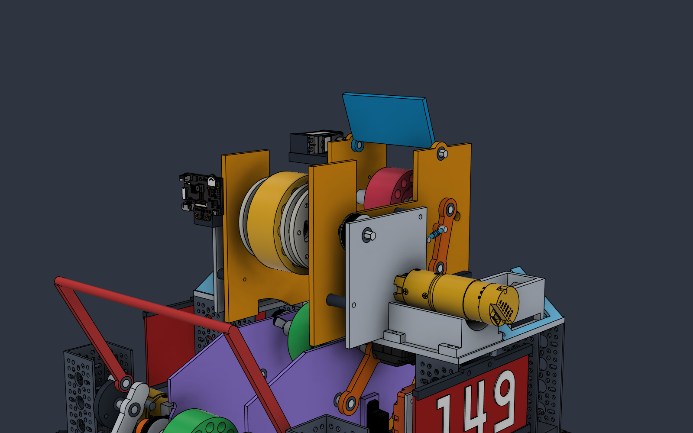
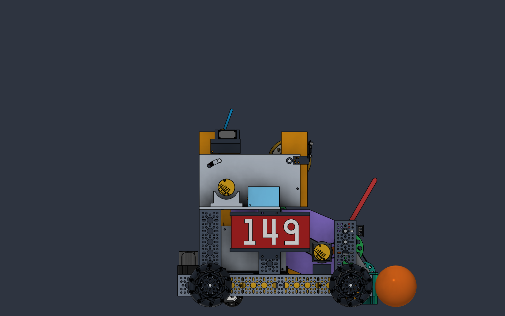

# 02 — Project HIVE-QUEEN v12: Part-by-Part Subsystem Engineering, Kinematics & Design Choices

**Team:** FTC Team 149 · **CAD:** Fusion 360 `BHHS FTC 149 / Default Project / FTC 26-27 / HIVE QUEEN v111426m` (v12.6 production pass; v12.3 buildability pass `HIVE QUEEN v111426e`; earlier passes `HIVE QUEEN v111426` = v12.0, `v111426b` = v12.1 and `v111426c` = v12.2 kept for reference) · local STEP `cad/STEP/project_hive_queen_robot_v12.step`

**v12 verification (re-run on the saved document, `cad/verify_v12_gates.py` → `cad/out/v12_gate_report.json`):**
`1,808` visible solid bodies · **`0` unfiltered B-Rep overlaps** (every body pair, no masking) · `0` multi-lump / sub-0.25 cm³ custom bodies · **every custom body chained to the chassis by contacts ≤ 0.15 mm (Gate 10)** · **6 mechanisms swept through full travel with 0 collisions (Gate 9)** · stowed `444.0 × 447.6 × 445.6 mm` (R102) · expanded `464.8 × 447.6 × 445.6 mm` (R105) · `91.95 mm` NECTAR clears all 10 path stations · all 7 HTD-5M belts exact to `0.003 mm`.

All numbers below come from the single source `cad/v12_design.py`, which both the builder (`cad/run_full_robot_upgrade.py`) and the gate script import, so the documentation, the CAD and the audit can't drift apart. Frame: `+X` forward, `+Y` left, `+Z` up, `Z = 0` on the tiles, millimetres.

> **v12.2:** the endgame FLOWER capper (S7 arm, C-cup and tower bracket) was removed; see §9. Endgame = more HIVE tips.

> **v12.1 changes (from a design review of v12.0):**
> * The intake's centre star roller is now a **5th compliant wheel**. In the parked pose the star roller cleared gecko 1, but its blades swept 0.2 mm into gecko 1 while spinning.
> * **Gecko 1's wheel-end hub is now 14 mm wide with two bearings.** The shaft stays supported from the right side only; see §6.
> * The **floor slits for the S3 gate fingers now cover the full 60° retract sweep.** In v12.0 the fingers hit the floor between 10° and 55°.
> * The **capper's floating mast and shelf are now one tower bracket** that clamps over the top of the upright. The R105.B hard stop moved to the far side of the deployed angle; in v12.0 it sat inside the arm's swing.
> * A **relief notch in the right side plate** clears the gecko 2 pulley when it lifts for a Nectar (2 mm clash in v12.0).
> * **M8 is now 1150 RPM** (v12.2; 435 RPM in v12.1 was not enough). A pinched ball moves at half the gecko speed, so the last ball now coasts 239 mm across the 48.6 mm gap above gecko 2. There is no room for a third gecko; see §6.1.
>
> These were found by the new Gate 9 (mechanism sweeps) and Gate 10 (support chain), which v12.0 didn't have.

> **What changed from v11 (`HIVE QUEEN v111326`) and why.** v11 *looked* clean because its audit filtered out overlaps with `trim_scene`/`trim_prev` cutters. Run unfiltered, it had real interferences (motor shafts through axles, gecko shafts through shrouds, belts that didn't close on a real tooth count, a keyhole in the arc slot, floating pods). v12 removes every masking cutter and makes every clearance explicit geometry, so the B-Rep audit has the final say.

---

## v12.6 production pass (CAD `HIVE QUEEN v111426m`)

A whole-robot "can it be built and wired" review found parts that every geometry gate passed but nothing held. Contact is not
fastening, so each was given a real screw path, and the audits (`cad/fastening_audit.py`, `cad/cots_mount_audit.py`) now classify
parts by whole name tokens instead of substrings (the old skip list let "wheel" and "bearing" hide four unfastened parts).

| Change | Why | Result |
|---|---|---|
| **Flywheel motor saddles (M5/M6)** get 8 mm base ears with 4x M4 x 12 into tapped deck holes | They rested on the deck unscrewed | Screwed down; ears stop at X 36 mm so they clear the left G409 shield |
| **M7 saddle** becomes a cradle plus a sleeve over the gearbox, 4x M4 x 12 into its tapped side holes | M7 sat on a block held by nothing | Same scheme as the M8 sleeve |
| **Intake bearing/stop plates** get 2x M4 to the upright web (right side through two printed bosses, because that upright is mirrored with its open side facing the plate) | Unscrewed | Screwed down |
| **Servo torque paths:** goBILDA **4001-0025-4008** clamping servo-to-REX couplers on S1, S3 and S6; the indexer shaft, the G407 blocker's left stub and the hood stubs are now real 8 mm REX, and the gate/hood bores are REX | The gates and hood sat on round shafts, so the servos could not turn them | Each servo drives its mechanism. The coupler's REX flats sit at 0/60/120 deg, the shaft phase. S6 moved 6.3 mm outboard to fit its coupler; the blocker's left stub runs in a 1611 REX flanged bearing in the upright web |
| **CNC plates** (deck, side plates, shear plates) are flat 2D parts: the shear-plate bosses became printed **standoff tubes** (M4 x 35 / x 40 through-bolts into tapped side-plate holes), the side-plate feet became printed **L-brackets** | Bosses and feet are not 2D-cuttable, and heat-set inserts do not belong in aluminium | `cad/export_cnc.py` verifies one thickness, all holes through, and writes `cad/CNC/*.dxf`, `*.step` and `HOLE_TABLE.md`. The drill now gives aluminium clearance or tapped holes, never insert holes |
| Plate stock stays **metric 6.0 / 5.0 mm 5052** | The deck sits on the tower tops and carries parts on top, so it cannot grow to 6.35 mm (0.250") or shrink to 4.75 mm (0.187") without moving everything | Order from **JLCCNC** (5052 in 5/6 mm, taps holes). SendCutSend, OSH Cut and Protocase stock inch sizes only |
| **Real flywheels:** 2x goBILDA **3628-0032-0082** plates (82 x 6 mm, 152 g, 1651 g-cm2) per side, bolted through the 32 mm pattern of a goBILDA **1313-1632-4008** hub (plates clocked 45 deg); the main shaft is now REX | The source model's "flywheel" was a solid 82 x 10 mm REX disc (~415 g) that goBILDA does not make | ~4.0 J stored at 1050 RPM, so a NECTAR shot costs ~15 % of it (~7.5 % speed drop) instead of ~30 % with one plate per side |
| **Ball-count sensors** moved to queue slots 2 and 3 (slot 1 = throat Color V3, slot 4 = lip Color V3) | The old spots straddled slots: ballCount2 saw the held ball, so the code read "full" with one ball aboard | The code counts by slot occupancy (`BallCounter`), with lip/throat edge counting as the primary count |
| **Sign slide rails bolted to the mid towers:** bottom rails get a tab to Z 106, top rails a base to Z 213, each with 2x M4 on the tower's hole grid (right: M4 x 16 + nylock into the tower wall; left: the tower's open side faces out, so M4 x 60 crosses the channel through printed spacer tubes to its far wall) | The rails only rested on the towers (the old audit exempted anything named "sign") | Fastening audit: 63 parts checked, 0 unfastened |
| **Hole driller rejects crossing and tangent holes** (with their mated hole) | A side-plate joint hole ran through a deck-joint hole (two inserts in one place) and a hole tangent to a face tore the printed mesh | 5 holes / 6 joint pairs dropped; 60/60 print files watertight |
| **Sign plate 174 x 78 mm** | The rail lips cover 3 mm top and bottom, so only 4.25 mm of the old border showed (R403 needs 6 mm) | 7.25 mm visible border, 72 mm visible background |

The servo models draw their 25T output spline as a plain cylinder at the tooth tip diameter, while the coupler is modelled at the
tooth root, so the two always "overlap" ~15 mm3 although real splines mesh. The spline stand-in is hidden on the three coupled
servos (the coupler covers it). Gate 9 now rotates each gate together with its REX shaft, coupler and servo spline.

## 1. Strafer Chassis, Clean Drivetrain & `24 mm` Grid


*Figure 1: Underbelly iso — 2 floor-touching odometry pods, battery bay, mid cross-channel.*

* **Side rails** `gobilda_1120_17hole_left:1/:2` (`1120-0017-0432`): `X ∈ [-216, 216]`, `|Y| ∈ [132, 180]`, `Z ∈ [24, 72]`, web-up. The left rail is **grounded** and the whole assembly sits in one `RigidGroup` (`HIVE_QUEEN_v12_rigid`) so nothing can be dragged out of place.
* **Cross-channels** `gobilda_1120_10hole_rear:1/:2/:3`: rear (`X ∈ [-216,-168]`), upper rear (`Z ∈ [168, 216]`), and the **mid cross-channel at Hole 8 (`X ∈ [-48, 0]`)**. The mid channel is a true COTS instance placed by its measured bounding box. Copying a nested proxy's `transform2` put it 132 mm off in Y.
* **Drivetrain (B6):** four `312 RPM` 5203 motors live inside the rails (shaft `Z = 48`) and drive the wheels through **goBILDA 2315-4008-0030 steel miter gears** (MOD 1.25, 30T, 1:1) with the cone apex at `Y = ±156`. **v12.6:** these are now goBILDA's own STEP models, not hand-drawn cones (the old model was ~32 mm across; the real gear is 37.5 mm pitch diameter). The apex was measured from the model: its tip cone (47.7°) and root cone (41.8°) meet 20.56 mm in front of the back face, which would leave the axle gear's back 0.94 mm off the rail wall. goBILDA puts a thrust bearing in the gear's dished back to set its position (their product page and Strafer kit); measured in both STEPs, that bearing stands 1.01 mm proud, so the gear is modelled where the bearing actually puts it, 0.08 mm deeper into mesh. The motor face moved to axle − 30.0 mm so the 24 mm shaft passes fully through the 13 mm pinion, and the builder solves the tooth phase the way the real robot is assembled: the pinion's REX bore sits on the motor shaft's flats, and the free axle is turned until the teeth mesh (axle gear at 9.45°, zero overlap at all four corners). The axles are now modelled as real REX (hex flats 3.48 mm, rounded corners) aligned to the gear bore. Each wheel turns on a clean `85.9 mm` REX axle in **two seated `1611-0514-4008` bearings** (rail walls at `|Y| 132–134.5` and `177.5–180`). v11 had motor shafts passing straight through the axles.
* **v12.4: front axles moved out one hole, to `X = +168` (rear stays at `−144`).** With all four axles at ±144, the two motors on each side met back-to-back with **0 mm** between their encoder caps. A 5203's power cable and encoder port both leave *radially* from the side of that cap, facing down out of the rail's open bottom, so two motors' cables had to come out of the same 28 mm-wide spot with no room to bend. Moving the front pair gives a **24 mm gap** (19.2 mm since v12.6, after the motors moved 2.4 mm for the real miter pinion). The rear can't move: an axle at −168 lands on the rear crossbar. Wheelbase is now 312 mm, centred 12 mm forward. The drive code is a plain mecanum mix with no wheelbase constant; any slight off-centre turning is corrected by Pinpoint and heading lock.
* **v12.4: motor mounts.** Nothing held the drive motors before. Each now has a goBILDA **1201-0043-0002 Quad Block Pattern Mount**, exactly as in goBILDA's Strafer kit. The block fills the channel's 43 mm interior at the gearbox face: 4× M4 into the motor face, and M4 into the channel walls.
* **Mecanum wheels** touch the tiles at `Z_min = -0.145 mm`.


## 2. 2-Pod Dead-Wheel Odometry + Pinpoint v2 (B7)

**Pinpoint v2 has exactly 2 encoder ports**, so v12 runs 2 pods. v111326 carried a third, redundant right X-pod that the computer couldn't read. Dropping it saved about 250 g and $90.

| Element | Occurrence / body | World AABB (mm) | Notes |
| :--- | :--- | :--- | :--- |
| Left forward X-pod | `official_gobilda_4bar_odometry_pod:1` + `odom_pod_left_x_rail_cradle` | tyre at Z −0.15 (tight); pivot `(-133, Y, 23.9)` | Bracket clamps both ends of the pod's REX pivot shaft: inboard plate (Y 84.8–88.8) + arm + tab on the left rail's inner wall |
| Rear-centre Y-pod | `official_gobilda_4bar_odometry_pod:2` (clone, rotated 90°) + `odom_pod_center_y_strafe_rear_cradle` | tyre at Z −0.15 (tight); pivot `(X, -24, 23.9)` | Bracket clamps both shaft ends: front plate (X −125…−120.9) + arm + tab on the rear crossbar wall |
| Pinpoint v2 | `official_gobilda_pinpoint_v2:1` + `pinpoint_v2_mount_plate` | `X[-12,28] Y[-98,-55.5] Z[75.2,93.2]` | On the mid cross-channel, short encoder runs. **v12.6:** the spacer used to rest there unscrewed; now 3× M4 hold it to the channel (X −40 end), the Pinpoint's two overhanging corners take M4 + nylock, and its two corners over the channel web thread into the PETG spacer. It can't move to a fully hole-aligned spot (chute wall at Y −55.0, Control Hub at Y ≤ −99.5) |

**v12.4 correction: the dead wheels did not touch the floor before.**
* Fusion's `boundingBox` is not tight on curved bodies. The omni wheel's side plate claimed Z −0.24, while the real tyre bottom was **+6.02 mm**.
* Both v12.0–12.3 placement and gate 6 used those loose boxes, so they "passed" pods whose wheels were 6 mm in the air.
* Both pods now sit 6.17 mm lower, with the tyres' *tight* lowest point at Z −0.15, the same squash as the mecanum wheels. Gate 6 now measures only the tyres, with oriented (tight) bounding boxes.

**How the pods mount.** The model is goBILDA's **swingarm pod** (3110-0001-0001): the whole pod swings on bearings around an 8 mm REX pivot shaft that runs through it, and a torsion spring presses the wheel down.
* The old cradles sat ~18 mm above the pods and held nothing.
* The new brackets clamp only the two shaft ends, in REX holes, and never touch the swinging body.
* The pods' X/Y positions are unchanged, so TeamCode's Pinpoint offsets still apply.

## 3. Asymmetrical Funnel, Floor-Skimming Lip & G407 Blocker


*Figure 2: Intake front close-up.*

* **Funnel wings** (`asymmetrical_funnel_wing_left_long` / `_right_short`): bolted to the rail front faces, `X_max = 228.0 / 222.0`, so the left wing touches a ball 6 mm before the right one and turns two side-by-side balls into single file. They were trimmed from v11's 239.5 / 230.0 mm to keep the stowed robot inside **448 mm** (R102).
* **Low wedge lip (B3):** the unified chute's front edge is a wedge cut flat **5 mm above the tiles**. It was 1.5 mm in v12.0–12.1, which would catch on foam-tile seams and lifted edges. The funnel wings likewise sit 6 mm up instead of 2 mm. A ball still rolls straight onto the 23° ramp: a 7 mm step is climbed at a 37° contact angle (POLLEN), well within the intake wheels' push. Raising the ramp moved gecko 2 slightly along the bend. Its bend angle is now *solved* so the M8 → J2 belt stays an exact 260 mm.
* **S1 impact guard (v12.2):** S1 sits outside the left upright, flush with the wheel face but higher up, where another robot's frame hits. A printed 5-sided cage (`s1_servo_guard_cage`, 2 mm walls, 1 mm clearance) bolts to the upright and takes the hit. Stowed width goes to about 448 mm, under R102's 457.
* **G407 front-lip blocker** (`g407_front_lip_blocker_gate`, servo **S1**): pivots in the upright's 14 mm hole at `(156, 168)` and drives a full-width bar. **Deployed**, the bar sits at `(218, 52)` across the mouth. **Stowed**, it is at 59.9°, with the bar at `X = 222`. A REV Color Sensor V3 (`rev_color_sensor_v3_lip`, v12.5 vendor model) looks **across the mouth** from a 6 mm pad built onto the chute's left mouth curb (`X 142–188`, `Y 55–61`). Its lens is at `(167, 43.5)`, at ball height, behind a 12 mm window. It is held by two M3 screws into inserts that stop at the curb face. The old 13 × 14 × 5 mm placeholder sat loose on the funnel wing, and the wing's face points forward, so a sensor there would have missed balls entering the middle of the mouth.

## 4. Floating Front Intake (coaxial belt-on-pivot)

* **Upper pivot** `(156, 144)` on two stub shafts. Each runs in a bearing in the upright stop-plate (`intake_upright_bearing_and_stop_plate_*`, `|Y| 124–131.9`).
* **Swing arms** `floating_intake_swing_arm_left/right` (`|Y| 100–108`, `R = 80 mm`) carry the floating REX shaft with **five 47 mm spoked compliant wheels** (`Y = 0, ±38, ±72`). **Both hubs carry their own bearings.**
* **Hard stops:**
  * The lower stop pin sits under the arm (`r = 40`). It holds the shaft at `(198.94, 76.5)`, so the 47 mm compliant wheels reach `Z_min = 53.0 mm` (≥ 15 mm bite on a floor POLLEN).
  * The upper stop pin catches the tail at `(225.28, 104.0)`. This is the R105 pose used in the expansion check.
* **Belts (exact):**
  * Stage 1: M7 `(103.41, 120.74)` → pivot, `20T/20T`, **215 mm (43T)**. HTD-5M 9 mm belts on 12 mm pulleys (v12.6; the lane is now `Y 55.6–67.6`).
  * Stage 2: pivot → floating shaft, `20T/20T`, **260 mm (52T)**.
  * Both centre distances are fixed by geometry, so the belts never change length as the arm floats.
* **M7** sits 17 mm further outboard than in v11, so its shaft tip stays out of the 102 mm ball corridor.
* **M7 = 1150 RPM** (`5203-2402-0005`). Both belt stages are 20T:20T, so the 47 mm wheels turn at motor speed: **2.83 m/s, 1.8× the 1.57 m/s drive top speed**, enough to pull balls in at full drive speed. The original 312 RPM gave only 0.77 m/s, half of drive speed, so the robot would have bulldozed balls ahead of it. The CAD body is the longer 312 RPM gearbox, so real clearances only grow.

## 5. Unified Continuous J-Chute (B1)


*Figure 3: Right-side internal cutaway — wedge lip → 23° ramp → R100 J-bend → vertical wall → shooter nip, with queued POLLEN.*

`unified_continuous_j_chute` is **one single-lump body** (`412.8 cm³`):

1. **23° ramp**, `z_r(x) = 3.5 + tan 23° · (184 − x)`. The angle went up from 18.5° because the floor has to clear the `X ∈ [-48, 0]` mid cross-channel (top `Z = 72`). At `X = 0` the floor is at `Z = 81.6`.
2. **R100 J-bend** around `C = (-10.0, 194.48)`, sweeping from the ramp tangent `(-49.07, 102.43)` at 247° to 180°.
3. **Vertical rear wall**, inner face `X = -110`, up to `Z = 276` (below the counter-wheel swing).
4. **12 mm curbs** in `|Y| 51–55`, giving a **102 mm clear corridor**.
5. **Four bolted mounting stations:**
   * front hangers to the rail inner walls (`X 150–170`);
   * a saddle on the mid cross-channel (`X -47.5…-0.5`);
   * a rear collar to the upper rear crossbar (`X -119.95`);
   * the gate-shaft hanger under the bend.

**Nectar sweep (Gate 5).** A `Ø91.95 mm` sphere has 0 overlap with fixed geometry at 10 stations:

* intake mouth, floor wedge, lower ramp, over the mid crossbar;
* J-elbow, deck throat (`X = -64.0, Z = 219`), open gate;
* expanded nip, past the hood hinge at `Z = 382`, and at `Z = 415`.

## 6. Coaxial Gecko Magazine & Sprung Shrouds (B2)

The v11 "spring-in-a-slot" gecko axles changed belt length as they moved. v12 uses **belt-on-pivot swing arms**: each gecko arm pivots on the axis of the pulley that drives it.

* **Gecko 1** (`gecko1_coaxial_swing_arm_on_m8`):
  * pivots on the **M8 shaft** `(104, 121)`, `R = 57.0`;
  * rests at `(160.25, 130.19)` (9.28°) with a 3 mm bite on POLLEN, and lifts to `(149.63, 155.16)` (36.81°) for NECTAR;
  * belt b1: HTD-3M `33T/33T`, **213 mm (Gates 213-3M-06)**;
  * an extension spring on a 6 mm pin pulls it down onto the shroud slot end.
  * **Supported from the right side only, on purpose.** A left arm would have to pivot where the intake's stage-1 pulley and belt already are (18.5 mm from the shaft, while it needs ≥ 21.6 mm). The wheel-end hub is therefore 14 mm wide with **two bearings 7.4 mm apart** (planes B + C), so the ~70 mm overhang can't rock (static bend ≈ 0.09 mm at 20 N).
* **Jackshaft J2** `(32.15, 158.40)`: fixed. It is fed from M8 by b2 (HTD-3M `32T/32T`, **258 mm, Gates 258-3M-06**, centre 81.0 mm) and supported by bearings in both shrouds plus the outboard double-shear plate (`|Y| 86–91`).
* **Gecko 2** (`gecko2_coaxial_swing_arm_left/right`):
  * pivots on **J2**, `R = 57.0`;
  * rests in the bend at `(-6.56, 200.24)` and lifts to `(9.19, 210.57)`;
  * belt b3: HTD-3M `33T/33T`, **213 mm**;
* **v12.6: the magazine runs on HTD-3M 6 mm belts.** The CAD's belts had been drawn 5.2 mm wide, but nobody sells a 6 mm HTD-5M belt (9 mm is the narrowest; goBILDA sells only 9 mm). Three 12 mm-wide 9 mm-belt pulleys plus the gecko-1 arm would need ~30 mm on the M8's 24 mm shaft. HTD-3M 6 mm belts (Gates PowerGrip, standard lengths) run on printed 33T/32T pulleys 8.5 mm wide; their flanges use the gaps beside the arm plane, so b1 + arm + b2 = 23.8 mm and nothing else moved. 3M belts come in 3 mm steps, so G1_R/G2_R went 57.5 → 57.0 and M8→J2 went 80 → 81 to stay exact; the gecko-2 bend re-solved to 213.3°. Every stage is still 1:1, so the magazine speeds and code are unchanged.
  * a torsion spring on J2 returns it.
* **Shrouds** (`sprung_magazine_shroud_left/right`, `|Y| 51–55`):
  * true **concentric arc slots** about J2 (both sides) and about M8 (right side). No keyholes (Gate 7).
  * the left shroud has windows for **two ball-count sensors** (REV 2m Distance, `REV-31-1505`) and the **throat classifier** (REV Color V3).
  * **v12.5:** each real sensor sits on a 6 mm pad built into the shroud, face-down over its 12 mm window, held by 2× M3 into inserts. The inserts stop at the shroud wall, so nothing breaks into the corridor. Ball-count 1 lies horizontal because the stage-1 belt runs right above it.
* **Belt planes on the right**:
  * A `56.5–63.5` (b1/b3);
  * B `64.5–70.5` (arms);
  * C `71.5–78.5` (b2);
  * D `79.6–85.4` (torsion spring).
* Every arm hub carries a seated bearing. The right shooter side plate has a relief notch along the gecko 2 pulley's lift path.
* **M8 = 1150 RPM** (`5203-2402-0005`): gecko surface speed **4.34 m/s**.

### 6.1 Why two geckos and not three: the last-ball hand-off
* **Gecko 2 rides inside the bend** (arm on J2), pushing balls round it. Its last contact with a Pollen on the wall is at `Z = 222.9`. v12.3 *solves* its bend angle so the M8 → J2 belt stays exactly 260 mm after the ramp was raised 3.5 mm.
* The **counter-wheel first grabs a Pollen at `Z = 271.9`**, which leaves **48.6 mm with no drive** (53 mm before v12.3; less for a Nectar).
* **No third gecko fits.** I searched every position that grips a wall ball with a 3–5 mm bite (72 mm gecko and 48 mm compliant wheel). Every one hits gecko 2 or the front shooter wheel: 0 valid positions.
* **A pinched ball moves at half the gecko's surface speed.** It rolls between a moving gecko and the fixed chute floor/wall, so its centre travels at `v/2`. Once it leaves gecko 2 on the vertical wall there is no normal force, so its spin can't lift it: it coasts as a plain projectile.
* **Whole-path simulation of a lone ball** (intake → gecko 1 → ramp coast → gecko 2 → wall coast → nip), using the CAD geometry:

| M8 | Ball speed | Lone POLLEN | Lone NECTAR |
|---|---|---|---|
| 435 RPM (v12.1) | 0.82 m/s | **stalls at Z ≈ 253**, 19 mm short of the grab | reaches the nip at 0.40 m/s (marginal) |
| **1150 RPM (v12.2)** | **2.17 m/s** | reaches the nip at 1.91 m/s | reaches the nip at 2.05 m/s |

  * The minimum M8 speed is **545 RPM** to put a lone POLLEN into the nip, and **425 RPM** just to stage it from gecko 1 up to the gate.
  * At 1150 RPM the coast is `v²/2g = 239 mm` for the 48.6 mm gap (4.9× the energy needed).
  * The v12.1 "137 mm" figure wrongly used the full surface speed.
* A POLLEN held at the gate sits **1.1 mm short of gecko 2**. When the gate opens, the queue behind pushes it into gecko 2. A lone held ball rolls back to gecko 1 and is driven up again; the simulation above covers that case.
* Software: staging power `MAGAZINE_INDEX_POWER = 0.6` (needs ≥ 0.37).
* Feed at `MAGAZINE_FEED_POWER = 1.0` (≥ 0.6 if lowered to space shots).

## 7. S3 Indexer Gate & Throat Classifier


*Figure 4: Throat region with the left shroud hidden.*

* **Indexer gate** (`indexer_stopper_gate_3prong_fingers`, servo **S3**): pivots below the bend floor at `(-78.08, 89.65)`. To open, it rotates **+60° (toward the front, away from the held ball)**. At 60° every finger tip is at `r ≥ 108 mm` from the bend centre, below the floor. The floor slits follow the fingers' crossing points through the whole 0–63° sweep, and Gate 9 confirms the sweep is collision-free. Its three 4 mm fingers (`Y = 0, ±25`) rise through floor slits to `r = 66` at 237°. A queued POLLEN is held at `(-9.61, 124.31)`, 0.7 mm clear of gecko 2. When the gate opens, gecko 2 takes it.
* **Throat classifier** (REV Color Sensor V3) looks through the left-shroud window at the held ball. The software sets flywheel RPM and hood pitch *before* opening S3.

## 8. Fixed-Mount Topspin Shooter (B4/B5)



*Figures 5–6: shooter front-left iso and right ortho.*

* **Front wheel** `(32, 324)`: Rhino 96 + 2× 82 mm steel inertia discs on the main shaft. It runs in bearings in both side plates and both outboard double-shear plates.
* **Counter-wheel** `(-123.5, 324)`, 72 mm: carried by **coaxial swing arms on the M6 axis** `(-107.71, 264.90)`, `R = 61.175`. **Both arm hubs carry bearings.**
  * The **arc slot** (`R 61.175`, 104.96° → 128.5°, 9.2 mm wide) is cut identically in both side plates and the right double-shear plate.
  * Nip gap is **71.5 mm** at rest and opens to **93.7 mm** for NECTAR, with 0 belt stretch.
  * Two extension springs (`|Y| 68.5–74.5`) return the arms.
* **Belts:**
  * left: M5 `(-23.57, 266.45)` → front wheel, `20T:20T`, **260 mm** (HTD-5M 9 mm on 12 mm pulleys since v12.6; the lane moved to `Y 72.6–84.6` so the pulley seats against the double-shear bearing, and the old outer spacer is gone);
  * right: M6 → counter-wheel, `32T:16T` (2:1 overdrive), **245 mm (49T)** at `c = 61.175 mm` exactly. v12.6: lane moved out to `|Y| 75.2–87.2` to clear the return spring with a 9 mm belt.
* **Topspin (Gate 8):** `5203-2402-0005` (1150 RPM) gives front-wheel surface speed `5.78 m/s` and rear `8.67 m/s`, so `v_rear > v_front` and the exit speed is about `7.23 m/s`.
* **M6** is 5 mm further outboard than in v11 and coupled to the right pivot stub, so its shaft can't run into the arm hub.
* **Hood** (`variable_pitch_exit_hood_full`): the hinge moved 20 mm rearward to `(-116, 382)`, out of the NECTAR exit column. It is driven coaxially by **S6** through `hood_servo_shaft_coupler`. Top at `Z = 439.3`.
* **HuskyLens** (I2C; the spec chose it over the Limelight 3A, which is also legal per R702 Table 12-9): the real DFRobot SEN0305 model, front-right, with the lens at `(Y −86, Z 354)` facing forward.
  * It hangs by its two M3 ears from `dfrobot_huskylens_mount_block`. **v12.6 fix:** that block used to only *touch* the plate's 5 mm front edge, with no screws (the overlap and contact gates can't tell touching from fastened). It is now an L-bracket: a 5 mm flange lies on the plate's outboard face and 2× M3 × 12 go through flange + plate into nylock nuts on the inboard side. Gate 11 now also checks custom-to-custom screw joints, starting with this one.
  * The block stays behind the 3.5 mm screen on the back of the PCB, and only a lip under the screen reaches the ear standoffs.

## 9. Deck, Electronics, Power & Rule Compliance

* **Deck** `cnc_turret_mounting_deck_plate_clean` (6 mm, `Z 216–222`): throat cut-out `|Y| ≤ 55`, plus a relief for the gecko 2 swing.
* **Hubs** (R502/R505): rotated flat and moved **inboard** of the 17-hole rails (`|Y| 99.5–129`), each on a mount plate behind the rail.
* **Battery (v12.6): goBILDA 12V NiMH Nested Battery 3100-0012-0020** (goBILDA's replacement for the discontinued Matrix 14-0014; Table 12-4, manual p. 132), in goBILDA's own **1209-0001-0001 Battery Mount**: a profile-matched cradle with a hook-and-loop strap, so battery swaps need no tools. The mount sits on the rear crossbar's top web at `X -192, Y 12`; its counterbored M4 holes land on the crossbar's own holes (all eight checked), fastened with the 4× M4 × 10 + nylocks it ships with. Pack at `X -213…-171`, `Y -49…73`, `Z 80–123.6` (checked against the mount's profile walls: zero overlap, ±1.25 mm play), leads toward the switch side (+Y). Its XT30 lead plugs straight into the REV switch cable.
* **Thrust bearings (v12.6):** a goBILDA `1613-0516-0008` behind each axle miter gear, exactly as in goBILDA's Strafer kit. Its small washer drops into the gear's r 8 mm pocket (3.95 mm deep) and its large washer bears on the rail wall, so it sets the gear 0.08 mm inside the theoretical apex; the teeth still clear, with a zero-overlap window of 9.35–9.6° around the 9.45° phase (offline scan). It takes the miter's spreading force.
* **Servo power injector** (goBILDA 3125-0001-0001, real model): hung under the deck at `X −30…10, Y 75–117.5`. Four M4 screws go through its base (goBILDA 32 mm grid) into tapped holes in the aluminium deck. Fit them with the top case off.
* **Main power switch** (R603.B, REV-31-1387, real model): face-up on the printed `rev_main_power_switch_housing`, with 3× M3 into inserts.
  * The switch body sits in the housing's cavity, and its leads drop through a deck hole into the free bay above the Expansion Hub.
  * The 4-sided cage now rises to `Z 264`, above the rocker top at `Z 261`.
  * The left G409 roof is open over the cage, so the rocker stays reachable from above.
* **v12.5: no placeholder devices remain.** Every sensor, the switch, the injector and the camera are vendor STEP models placed by their real mounting holes. The new **gate 11** proves each one has screw paths (a hole in a printed or CNC part on every mounting-hole axis, with material around it). Gate 10 had accepted plain boxes that merely touched a face.
* **G409 shed roofs** (`g409_sloped_deck_shed_shield_left/right`): hollow 40° PETG roofs over the flat deck pockets, so balls spilling from a tipping HIVE roll off instead of lodging. The left roof is cut away around the power-switch cage.
* **No FLOWER capper (removed in v12.2).** Endgame time goes to more HIVE tips instead. Each tip is worth 20 pts and counts toward both Pollinator RPs, and at `1:00` every remaining staged NECTAR unlocks, which feeds 5-NECTAR (206.4 g) tips. A cap scores about 7 pts, earns no RP, and costs a trip to the wall. Removing it also took S7 and about 0.3 kg off the robot. The robot never puts NECTAR into a FLOWER, so G410 can't be broken. Expanded envelope (intake on its upper stop): `464.8 × 443.7 × 439.5 mm`, inside R105 `609.6 × 457 × 736.6`.
* **Signs** (R401–R403): `174 × 78 mm` plates with **57.5 mm** white numerals and a 7.25 mm border visible inside the 3 mm rail lips, held in tool-less slide rails on both sides (180° apart). Each side reads "149" correctly from outside. Red and blue multi-colour `.3mf` files are in `cad/3MF/v12/`.

## 10. Reproduce / Re-verify

```bash
python cad/fusion_cli.py run-file cad/tmp/import_base.py --timeout 500        # clean baseline STEP into a new doc
python cad/fusion_cli.py run-file cad/run_full_robot_upgrade.py --timeout 850  # v12 build (~90 s)
python cad/fusion_cli.py run-file cad/verify_v12_gates.py --timeout 1150       # gates 1-10 -> cad/out/v12_gate_report.json
python cad/fusion_cli.py run-file cad/export_v12.py --timeout 560              # STEP + per-part .3mf
python cad/build_sign_3mf.py && uv run --with openpyxl python cad/build_bom_v12.py
```
