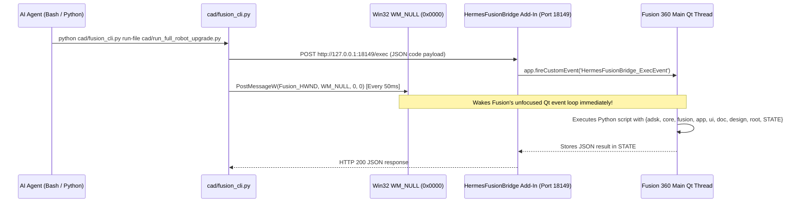

# 03 — AI Agent Engineering Guide: Autodesk Fusion 360 Live API, `HermesFusionBridge` & Project HIVE-QUEEN CAD Workflow

**Target Audience:** Future AI coding/CAD agents (and human engineers) editing, auditing, rendering, or extending **Project HIVE-QUEEN** (`26-27-BIOBUZZ`).

---

## 1. Architecture of the Live Fusion 360 Bridge (`HermesFusionBridge`)

This repository drives a live desktop instance of **Autodesk Fusion 360 (`v2706.1.17`)** over a local HTTP bridge running on `http://127.0.0.1:18149`.



### 1.1 Key Files & Paths
* **Fusion 360 Add-In (Auto-loads on Fusion startup):**
  * `%APPDATA%\Autodesk\Autodesk Fusion 360\API\AddIns\HermesFusionBridge\HermesFusionBridge.py`
  * `%APPDATA%\Autodesk\Autodesk Fusion 360\API\AddIns\HermesFusionBridge\HermesFusionBridge.manifest` (`"runOnStartup": true`)
* **CLI Client (in this repo):**
  * `C:\Users\danu0\Downloads\26-27-BIOBUZZ\cad\fusion_cli.py`
  * Commands:
    * `python C:/Users/danu0/Downloads/26-27-BIOBUZZ/cad/fusion_cli.py status` — Returns active document name, `design_type`, top-level occurrences, and bounding boxes.
    * `python C:/Users/danu0/Downloads/26-27-BIOBUZZ/cad/fusion_cli.py exec "<python_code>"` — Runs inline Python on Fusion's main thread and prints `result` as JSON.
    * `python C:/Users/danu0/Downloads/26-27-BIOBUZZ/cad/fusion_cli.py run-file C:/Users/danu0/Downloads/26-27-BIOBUZZ/cad/run_full_robot_upgrade.py` — Executes a `.py` script file on Fusion's main thread.
    * `python C:/Users/danu0/Downloads/26-27-BIOBUZZ/cad/fusion_cli.py screenshot C:/path/to/out.png --width 1600 --height 1000` — Captures the active viewport.
* **Master Upgrade & Full-Assembly Audit Script:**
  * `C:\Users\danu0\Downloads\26-27-BIOBUZZ\cad\run_full_robot_upgrade.py` — Builds all `115+` custom B-Rep solids inside a single `BaseFeature` component (`Variable_Intake_And_Asymmetrical_Funnel`), positions all COTS occurrences, spawns the cloned 95-body Odometry Pods and cloned 1,072-face Center U-Channel, and runs an in-process full-assembly B-Rep intersection audit across all `1,152` visible solid bodies in **`~1.0 second`**.
* **Original `build123d` Base Generator (Reference for Native COTS Names/Origins):**
  * `C:\Users\danu0\Downloads\26-27-BIOBUZZ\cad\src\robot_assembly.py`
  * `C:\Users\danu0\Downloads\26-27-BIOBUZZ\cad\src\config.py`
  * `C:\Users\danu0\Downloads\26-27-BIOBUZZ\cad\src\printable_parts.py`
* **STEP Assemblies:**
  * Base STEP input imported by `run_full_robot_upgrade.py`: `C:\Users\danu0\Downloads\26-27-BIOBUZZ\cad\STEP\project_hive_queen_robot.step`
  * Upgraded STEP deliverable: `C:\Users\danu0\Downloads\26-27-BIOBUZZ\cad\STEP\project_hive_queen_robot_upgraded.step`

---

## 2. The 7 Golden Rules of Fusion 360 API in This Repo (Read Before Editing!)

Every rule below was discovered empirically while engineering this robot. Violating any of them will cause either a **120-second timeout hang** in Fusion 360's parametric solver, **wrong COTS world coordinates**, or **silent boolean gouging/clipping**.

### Rule 1: Fusion 360 Internal Units Are CENTIMETERS (`cm`), Not Millimeters (`mm`)!
* Fusion 360's internal database unit for `Point3D`, `Vector3D`, `Matrix3D.translation`, `TemporaryBRepManager`, and `boundingBox` is **centimeters (`1 cm = 10 mm`)**, and `BRepBody.volume` is in **cubic centimeters (`1 cm³ = 1,000 mm³`)**.
* Always use the helpers in `run_full_robot_upgrade.py`:
  * `pt_cm(x_mm, y_mm, z_mm)` $\rightarrow$ divides by `10.0`.
  * `vec_cm(x_mm, y_mm, z_mm)` $\rightarrow$ divides by `10.0`.
  * `make_box_mm(cx_mm, cy_mm, cz_mm, sx_mm, sy_mm, sz_mm)` $\rightarrow$ creates a `TemporaryBRepManager` box centered at `(cx_mm, cy_mm, cz_mm)` with dimensions `(sx_mm, sy_mm, sz_mm)` in `mm`.
  * `make_cyl_mm(x0_mm, y0_mm, z0_mm, x1_mm, y1_mm, z1_mm, r_mm)` $\rightarrow$ creates a cylinder from `(x0, y0, z0)` to `(x1, y1, z1)` with radius `r_mm` in `mm`.

### Rule 2: Strict 4-Step Execution Ordering in `ParametricDesignType` (`1.0s` vs. `>120s` Hang!)
When a STEP assembly is imported into Fusion 360 via `import_manager.importToNewDocument(opts)`, the document is in **`ParametricDesignType`** (with an active parametric timeline). In `ParametricDesignType`, **execution order determines whether the script finishes in `1.0 second` or hangs for `>120 seconds`**:

1. **Pre-Step 1 (Visibility Only — NEVER Touch `transform2` or `deleteMe()`):**
   - **NEVER call `occ_i.deleteMe()`** on an old `Variable_Intake_And_Asymmetrical_Funnel` occurrence when cloned 95-body odometry pods are in `root.occurrences` (deleting a timeline node forces Fusion to recompute 190 NURBS bodies and hangs). Instead, hide old upgrade occurrences with **`occ_i.isLightBulbOn = False`** (`0.0 ms`!).
   - Call `apply_cots_visibility_only()` to hide replaced COTS occurrences before building `scene_solids`.
   - **NEVER modify `occ.transform2` or call `root.occurrences.addExistingComponent(...)` before `bf.finishEdit()`!** Modifying transforms creates a pending position snapshot in the timeline, which forces `bf.finishEdit()` to recompute the entire assembly.
   - Because COTS transforms are applied in **Step 3** (after `bf.finishEdit()`), `scene_solids` must use the **exact analytical post-transform coordinates** for any repositioned COTS parts (`gobilda_gecko_wheel_72mm_1:1..3`, `gobilda_rhino_wheel_96mm:1`, `gobilda_counter_wheel_72mm_topspin:1`, `servo_s3`, `servo_s6`, `Pinpoint v2`, `opod2/3`, `u10_mid`).
2. **Step 1 (Single `BaseFeature` Construction):**
   - Create ONE new component `up_occ = root.occurrences.addNewComponent(core.Matrix3D.create())` and ONE `bf = up_comp.features.baseFeatures.add()`.
   - Call `bf.startEdit()`, construct all custom B-Rep bodies in memory via `TemporaryBRepManager.get()`, add them via `up_comp.bRepBodies.add(solid, bf)`, and call `bf.finishEdit()`.
   - **NEVER put a multi-hundred-face imported STEP NURBS body (`tb.copy(cots_occ.bRepBodies.item(0))`) into `up_comp.bRepBodies.add(solid, bf)`!** `bf.finishEdit()` heals every body in `up_comp.bRepBodies` and will hang on complex imported NURBS surfaces. Spawn cloned COTS parts as component occurrences in Step 3 instead!
3. **Step 2 (Assign Appearances Before Transforms):**
   - Immediately after `bf.finishEdit()`, look up committed bodies by name (`up_comp.bRepBodies.itemByName(b_name)`) and assign `b_obj.appearance = palette[ckey]`.
4. **Step 3 (Spawn Cloned COTS Component Instances & Apply All `transform2` Updates):**
   - Spawn/reuse `official_gobilda_4bar_odometry_pod:2`, `official_gobilda_4bar_odometry_pod:3`, and `gobilda_1120_10hole_rear:3` (`u10_mid_occ`) via `root.occurrences.addExistingComponent(...)`.
   - Call `apply_cots_visibility_and_transforms()` to apply all `occ.transform2` updates (using `occ.isGrounded = False; occ.transform2 = mat` — **never** set `occ.isGroundToParent = False` on `addExistingComponent` instances or Fusion raises `RuntimeError: 3 : Component instance is not eligible for GTP`).
   - Commit a single `if design.snapshots.hasPendingSnapshot: design.snapshots.add()`.
5. **Step 4 (Fast Full-Assembly B-Rep Intersection Audit):**
   - Skip microscopic internal bearing balls (`OR:`, `IR:`, `Balls:`, `Cage:`, `Shield:`, `M(90`, `Encoder v1`, `M2.5`), group multi-body COTS pods by top occurrence name in `part_group()`, and run `tb.booleanOperation(c1, c2, IntersectionBooleanType)` on every AABB-overlapping pair.

---

### Rule 3: How `trim_scene` and `trim_prev` Can Mask Clipping (and How to Prevent It!)
In `run_full_robot_upgrade.py`, `add_solid(solid, name, color, trim_scene=True, trim_prev=True, register_cutter=True)` boolean-subtracts `scene_solids` (analytic bounding boxes of COTS parts) and `added_custom_solids` from `solid`.
* **The Trap:** If you accidentally place a custom part across a COTS bounding box (or completely inside one!), `trim_scene=True` will silently carve a rectangular bite out of your custom part—making Step 4's `overlaps_count` equal `0` while visually leaving the part gouged, severed into multiple floating pieces (`b.lumps.count > 1`), or completely deleted into a 0-volume body (which hangs `bRepBodies.add`)!
* **How to Prevent It:**
  1. **Never put `staged_pollen_*` sphere cutters into `scene_solids`!** If ball sphere cutters are in `scene_solids`, `trim_scene=True` punches circular holes through the bottom of the ramp instead of flagging ball-to-ramp clipping in Step 4!
  2. **Split COTS Motor Cutters (`M5` & `M6`):** A goBILDA 5203 motor (`gobilda_5203_motor_m5_shooter_master:1`) has its $\varnothing 52\text{ mm}$ yellow barrel at $|Y| \in [90.0, 206.6\text{ mm}]$, while only its $\varnothing 22\text{ mm}$ boss and $\varnothing 8\text{ mm}$ shaft extend inward to $|Y| \in [66.4, 90.0\text{ mm}]$. Never use a single giant AABB `|Y| ∈ [66.4, 206.6]` for `M5`/`M6` in `scene_solids`—split it into a motor barrel box (`|Y| >= 90.0 mm`) + a cylindrical shaft/boss cutter (`R = 11.5 mm` at `|Y| ∈ [66.2, 90.2 mm]`) so the double-shear plate at `|Y| = 87.2 mm` bolts flush against the motor faceplate without getting a $52\times 52\text{ mm}$ hole carved out of it!
  3. **Verify `multi_lumps == []`:** Always check `[b.name for b in up_comp.bRepBodies if b.lumps.count > 1]` after any geometry edit to confirm no custom body was severed into multiple pieces.
  4. **Inspect Multi-Angle Renders with `vision_analyze`:** Always capture close-up orthographic/isometric renders (`1600×1000`) of any modified subsystem and inspect them visually.

---

### Rule 4: COTS Occurrence Transform Conventions (Baked-In STEP Offsets vs. Origin-Centered Parts)
When moving an existing COTS occurrence in `s1`, `s2`, `s3`, or `tur`:
* Some COTS occurrences (`gobilda_gecko_wheel_72mm_1:1..3`, `staged_pollen_1_entering_mouth:1..5`, `gobilda_rhino_wheel_96mm:1`, `gobilda_counter_wheel_72mm_topspin:1`) have their local geometry centered at `(0, 0, 0)` and their world position stored in `occ.transform2.translation`. For these, `set_occ_transform(occ, mat_pos_mm(wx, wy, wz))` sets their world center directly to `(wx, wy, wz)`.
* Other COTS occurrences (`gobilda_1120_10hole_rear:1`, `gobilda_5203_motor_m1..m6`, `official_gobilda_12v_battery_14_0014:1`) have baked-in local STEP offsets (`occ.transform2` is either Identity or a relative offset). For these, always copy `m = occ.transform2.copy()` and apply a delta translation `m.translation = core.Vector3D.create(m.translation.x + dx_cm, ...)`!

---

### Rule 5: Handling Fusion 360 Startup & Post-Import Modal Dialogs Automatically
When Fusion 360 starts up on Windows or finishes `import_manager.importToNewDocument(opts)`, a modal Qt dialog (`class='Qt683QWindowIcon'`, `title='Fusion360'`) or a Recovery dialog can pop up 2–5 seconds later and block the main Qt thread until dismissed.
* **Proven Auto-Dismissal Pattern (Always run in a background thread during startup/import):**
  Send `VK_ESCAPE` (`0x1B`), `VK_RETURN` (`0x0D`), and `WM_CLOSE` (`0x0010`) via `ctypes.windll.user32.PostMessageW`:

```python
import ctypes, time, threading, subprocess

user32 = ctypes.windll.user32
WNDENUMPROC = ctypes.WINFUNCTYPE(ctypes.c_bool, ctypes.c_void_p, ctypes.c_void_p)
stop_flag = False

def modal_watcher():
    while not stop_flag:
        def cb(hwnd, lparam):
            if user32.IsWindowVisible(hwnd):
                buf = ctypes.create_unicode_buffer(256)
                user32.GetWindowTextW(hwnd, buf, 256)
                cls = ctypes.create_unicode_buffer(256)
                user32.GetClassNameW(hwnd, cls, 256)
                if "Recovered" in buf.value or (cls.value == "Qt683QWindowIcon" and buf.value == "Fusion360"):
                    user32.PostMessageW(hwnd, 0x0100, 0x1B, 0)  # VK_ESCAPE
                    user32.PostMessageW(hwnd, 0x0100, 0x0D, 0)  # VK_RETURN
                    user32.PostMessageW(hwnd, 0x0010, 0, 0)     # WM_CLOSE
            return True
        user32.EnumWindows(WNDENUMPROC(cb), 0)
        time.sleep(0.4)
```

---

### Rule 6: Re-Running After `export_mgr.execute(step_opts)` or `addExistingComponent`
* Once `export_mgr.execute(step_opts)` has been called on a document (or once `gobilda_1120_10hole_rear:3` has been added to `root.occurrences` in Step 3), running `bf.startEdit() ... bf.finishEdit()` a second time on that *same* dirty document can cause Fusion's parametric timeline to recompute all NURBS occurrences and time out.
* **Best Practice:**
  * If you are only adjusting COTS transforms or camera views, use `fusion_cli.py exec` directly on the open document (`<0.2 seconds`).
  * If you are rebuilding the `BaseFeature` via `run_full_robot_upgrade.py` after a previous STEP export, do a clean Fusion restart + fresh STEP import with `modal_watcher()` running so `run_full_robot_upgrade.py` is guaranteed to finish in **`1.0 second`**.

---

## 3. Standard End-to-End Workflow for Editing & Verifying the Robot

Whenever you modify `C:\Users\danu0\Downloads\26-27-BIOBUZZ\cad\run_full_robot_upgrade.py`:

1. **Apply Your Code Edit:** Use `patch` on `C:\Users\danu0\Downloads\26-27-BIOBUZZ\cad\run_full_robot_upgrade.py`.
2. **Execute on Clean Fusion 360 Session (`~1.0s`):**
   - Run `run_full_robot_upgrade.py` via `fusion_cli.py run-file` (with `modal_watcher` active if importing fresh).
3. **Verify All 3 Quantitative Gates in the JSON Output:**
   - `"overlaps_count": 0` (`"overlaps": []`) across all `1,152` visible solid bodies.
   - `"r102_pass": true` (all 3 envelope dimensions $\le 457.2\text{ mm}$).
   - `multi_lumps == []` (`[b.name for b in up_comp.bRepBodies if b.lumps.count > 1]` is empty).
4. **Capture Orthographic/Isometric Close-Ups & Visually Verify:**
   - Always call `doc.activate(); adsk.doEvents()` before accessing `vp = app.activeViewport`, set `cam.cameraType = core.CameraTypes.OrthographicCameraType`, and inspect the saved PNGs with `vision_analyze` (1–2 images per call).
5. **Export the Updated STEP File:**
   - Export to `C:\Users\danu0\Downloads\26-27-BIOBUZZ\cad\STEP\project_hive_queen_robot_upgraded.step` via `design.exportManager.createSTEPExportOptions(...)`.
